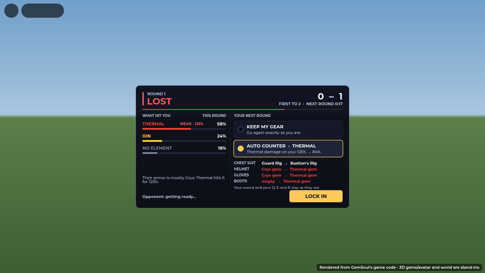
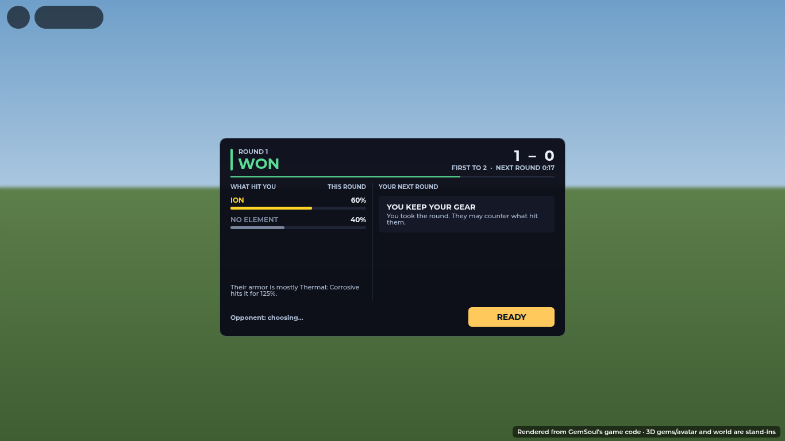
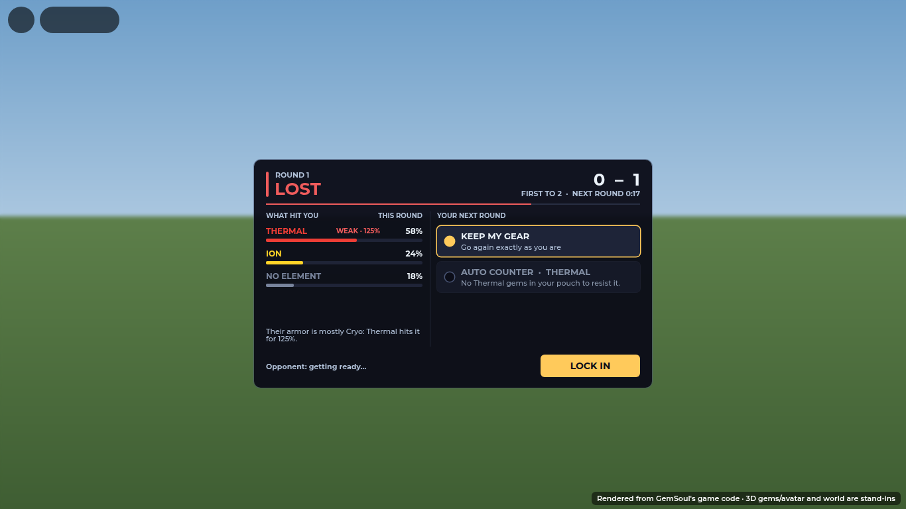
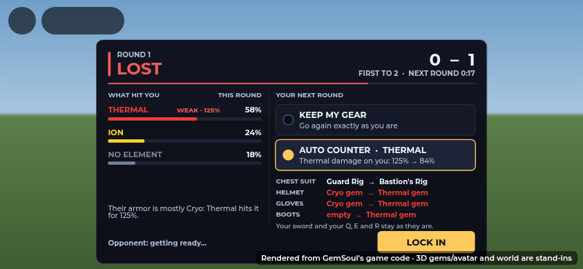
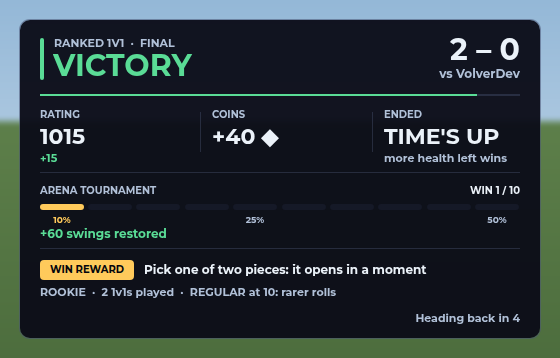
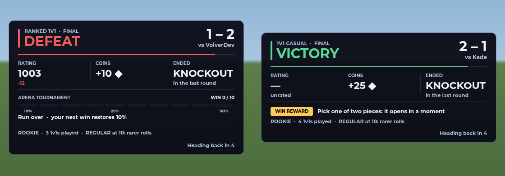
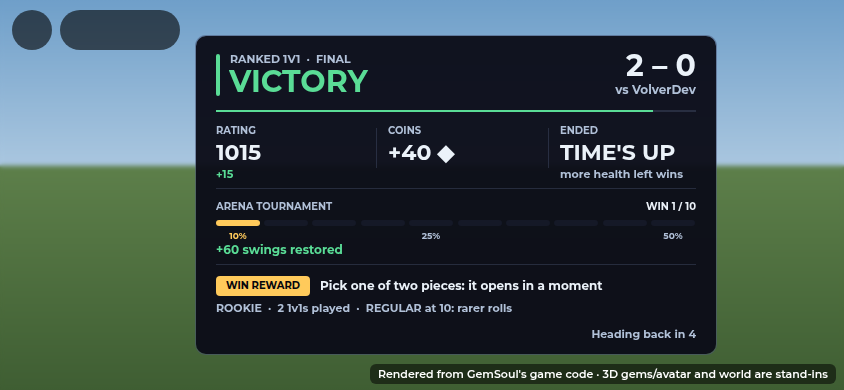

# Between ranked rounds: counter your opponent

A 1v1 match (Ranked or Casual) is first to 2 rounds. After every round, both
fighters get a short break before the next one starts. The player who lost the
round can change their armor in that break. They don't have to pick pieces by
hand: **AUTO COUNTER** does it for them.

## The round screen

When a round ends, this panel comes up for both players:

**Header.** It shows the round number and **WON**, **LOST** or **DRAW** in that
result's colour. The score is on the right, with the time left until the next
round. The thin line under the header runs down as that time passes.

**WHAT HIT YOU** (left). This is the damage you took in the round, split by
element. Each element has a bar that shows its share. An element your armor is
weak to says **WEAK · 125%**; one your armor gems already resist says
**RESIST**. If nothing hit you in the round, the column reads your opponent's
gear gems instead (**THEIR GEAR** in place of **THIS ROUND**). The line at
the bottom names your opponent's main armor element and which element beats it.

**YOUR NEXT ROUND** (right). The loser picks one of two options:

- **KEEP MY GEAR**: go again exactly as you are.
- **AUTO COUNTER · THERMAL** (the element that hurt you most): it shows how much
  of that damage you'd take after the change, e.g. *125% → 84%*.

Pick **AUTO COUNTER** to see each change it will make before you lock in:

Each row is one slot, from what's there now to what goes in. When there are
more changes than fit, the last row says **+N more**. Press **LOCK IN** when
you're happy.
If the timer runs out, you get whichever option is selected, so tapping
AUTO COUNTER and walking away still counters.

The winner sees **YOU KEEP YOUR GEAR** and a **READY** button. Only the loser
can counter:

When there's nothing to change, the counter row is greyed out and gives the
reason, for example *No Thermal gems in your pouch to resist it* or *Your armor
already answers it as well as your gems can*:

On a phone, the panel scales down to fit the screen:

When both players lock in (or time runs out), the next round's faceoff says
what each side did: **countered THERMAL** or **kept their gear**.

## Back into the fight by itself

The round screen frees the mouse while it's up, so you can click its options
and LOCK IN. When the next round starts, the screen closes and you're back
in first person with the mouse locked, ready to fight. You don't need to
press Tab. (Before, you had to press Tab to free the mouse, click, then press
Tab again to fight; until you did, the screen said "TAB · return to combat".)

## The end of the match

When the match is over, one card shows the result, in the same style as the
round screen:

- **Header:** RANKED 1V1 · FINAL over VICTORY, DEFEAT or DRAW in the result's
  colour, with the rounds' score and who you played on the right. The rule
  under it runs down until you're sent back.
- **RATING**, **COINS** and how it **ENDED** (knockout, time's up or
  forfeit), each a caption over a big figure with a small note under it
  (the rating change in green or red, a fill-in bonus).
- **ARENA TOURNAMENT** (a queued 1v1): ten segments, your run's wins lit, the
  wins that restore swings marked 10%, 25% and 50%, and what this one did.
- **WIN REWARD**: a gold chip when a reward is waiting, then your rolls' band
  and the next one. The reward board opens by itself once the card is gone.
  The gold "WIN REWARD READY" button waits until then too, so nothing stacks
  on top of the card any more.

A loss, and a Casual win (no rating, no tournament):

On a phone it scales down to fit:

## What the auto counter changes

Only armor. Your sword and your Q, E and R moves stay exactly as they are, so
you never go into a round with a move you didn't expect.

1. **Armor pieces.** If you own a Helmet, Chest suit, Gloves, Boots or Shield
   with a Defense roll against that element, it can swap one in. It only does
   that if your gear rating stays at 90% or more of what it was.
2. **Gems in Helmet, Gloves and Boots.** Each armor gem resists its own element
   (3.5–8% by grade, up to 35% in total). For each of those slots, the counter
   puts in the gem from your pouch that cuts the most damage from what hit
   you. If two gems are equally good, it takes the higher grade. It only takes
   gems from your pouch: it never moves a gem out of your weapon or shield.

The gem you take out goes back into your pouch, and the piece you take off goes
back to your gear bag, so you can put things back after the match.

If you took mixed damage (say Thermal and Corrosive), the counter weighs each
element by how much of it hit you. It never makes your total damage taken
worse.

The plan is worked out again on the server when it's worn, using your gear at
that moment. The screen only says "counter" or "keep".

## How it's built

| Piece | What it does |
| --- | --- |
| `Shared/CounterGear` | The counter logic: `threat` (what hit you), `expected` (damage you'd take with a loadout), `plan` (what to change). Pure functions, no services. |
| `Systems/CombatServer` | Keeps a running total of damage each fighter takes in a match, by element (`takenByElement`, `clearTaken`). |
| `Systems/CounterServer` | Connects the two for one player: `threat`, `offer` (the plan to show), `wear` (rebuild the plan and equip it), `newRound`. |
| `Systems/Duels` | At the end of a round, sends each fighter their own `Round` payload with `CanCounter`, `Threat` and `Counter`. It wears the counter when the next round is revealed. The winner can't pick it. |
| `Modules/RoundPivot` | The round screen above. While it's up, `Combat.client` frees the mouse; when it closes, the mouse locks again. |
| `Modules/MatchResult` | The card at the end of the match. |

The break is `Matchmaking.Rounds.Pivot` (30 s) when the loser has something to
change, and `Break` (10 s) when there is nothing to pick.

Tests: `tests/run_counter_gear.py` (the counter logic) and the counter cases at
the end of the rounds block in `tests/duels_cases.luau`.
