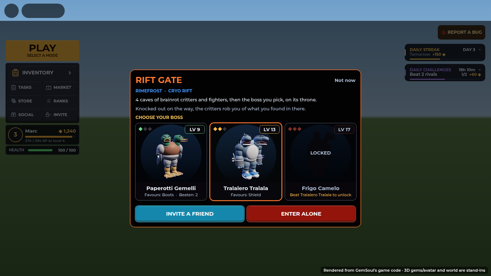
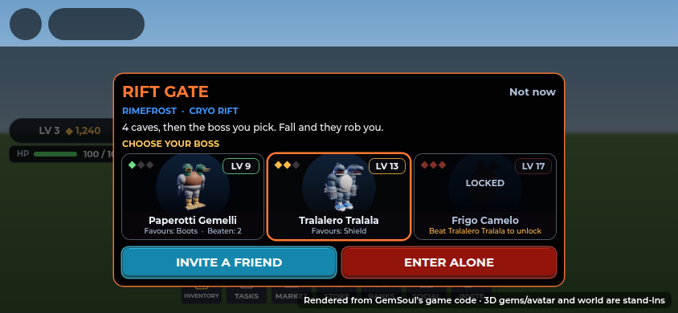

# The Rift: through a Rift Vein's gate into the critters' world

Each of the three Rift Veins in the quarry has a **Rift Gate** over its
dormant tear: a jagged arch of slate with fire at its feet. Walk up to one
and you can go through, into the critters' own world: a walled pathway of
caves open to a burning sky. You go in with your combat kit out and your
kaiju beside you, fight your way through cave by cave against brainrot
critters and the pathway dungeon's fighters that lead them, every one of
them tearing through the floor at you, then face one of the ten
brainrot bosses, picked at random, as a Colossus on its throne.

It's built for a party. You can go in alone, but the game warns you first.

The pictures are offline renders of the parts the server builds
(`Server/World/RiftWorld`, `Server/World/OutpostWorld.veinMarks`), drawn by
the trailer renderer. The actors are the game's own models posed at the
game's scales. They are **not Roblox screenshots**. Fire in the game is
Roblox `Fire` particles; the renders stand in a few glowing flame strips
for it, and the sky's ash and lighting are only roughly matched. The UI
shots are the real client code rendered by the UI harness.

## The gate

- **On the moon** (`OutpostWorld.veinMarks`): a scorched bed with glowing
  cracks, a 13-shard arch with neon inner edges and fire at its feet, and
  the vein's tear hanging in it, drawn in the Hell palette (`RiftTear`).
  The guarded vein's cracks are in its own red.
- **Its prompt**: **Enter the Rift** (`ProximityPrompt` on the gate's
  `Heart`, `PromptKind` "Rift", attribute `Vein` = the vein's index).
- **The card** (`RiftClient`), before you go in:

  - what's through it (the caves, the boss, your combat kit, robbery if
    you fall);
  - when you're alone, a warning box with the warning sign: **GOING ALONE
    IS VERY DIFFICULT**. "Invite a friend, or bring your party: up to 4
    can go in together." Then **INVITE A FRIEND** (the invite window) and
    **ENTER ALONE**;
  - with a party, how many of you there are and **ENTER**; if your party is
    already in there on the way, you join them;
  - **Not now**.

  On phones it's a compact two-column card:

  

- **Crossing**: the screen goes dark red for a moment with **THE RIFT**
  (and the warning again if you're alone), then the lighting turns hellish
  (`RiftClient.Hell`: a low red evening, thick red haze, no stars). Coming
  home puts the Outpost's lighting back.

## The way

The world is built for each trip, far off in the dark, and gone with it
(`RiftWorld.build`).

- **Its layout** is the pathway dungeon's: the landing, 4 caves, then the
  throne cave, each on a grid cell next to the one before, and the path
  never runs beside itself (`RiftRun.layout`). The first step is always
  straight ahead of the landing.
- **Caves** are 76 studs across (the throne cave 96), floored with basalt
  and glowing cracks, and **walled all round**: rock faces 34 studs high,
  boulders at their feet, jagged crowns, the odd ledge and glowing seam.
  There is nowhere to fall and no lava.
- **Passages** 22 studs wide join them, walled too, under a rock arch with
  fangs.
- **Walls of fire** bar the passage out of each cave until its pack is down.
- **The sky** (`Sky`): a burning scar across it, strands of light, 14
  low clouds lit from below, and ash falling (`Ash`).
- Through the floor somehow (20 studs under it), you're put back in the
  last cave you reached, unhurt.

## A trip

The rules are `Shared.RiftRun`; the server is `Server.RiftServer`.

| | |
| --- | --- |
| **Your kit** | Your combat kit comes out as you go through and stays out until you're home (`SparServer.riftKit`: hunting, as in the Outpost). You can't put it away in there: "Your kit stays out in the Rift." |
| **Packs** | Each cave's pack comes up when the first runner walks in, not before. **Every one of it comes through a tear of its own** in the cave's floor, in the critters' world's colours (the Outpost's tears, `RiftTear`, Hell palette): one opens every 0.45 seconds, at least 9 studs from the others and from any runner. The critters come first, leaping out at the nearest runner, then their leaders through taller tears (10 studs). Until the last is through, the pack is on its way: the strip counts it in foes left, and the cave can't clear |
| **Critters** | 3, 4, 4, 5 in caves 1 to 4 (never fewer than a team of three kaiju), plus 1 for each runner past the first. Brainrot critters from the Outpost's roster; a ranged one only at the back |
| **Big ones** | From cave 2, a 60% chance that one of the critters is a **Rift Brute**: 4x health, 1.5x damage, longer reach |
| **Fighters** | The pathway dungeon's regular fighters lead each pack (`Duelist.spawnDungeon`; `RiftLeader` on their models): 1, 1, 2, 2 in caves 1 to 4, plus one for every two runners past the first, armed and armoured to gear tier 1, 2, 2, 3, each with 1.5x a room fighter's health. One of the dungeon's roster per cave, with its element and moves. Anyone in the trip can hit them and be hit by them, kaiju too |
| **Level** | The critters come at your team's level (the average of the runners' lead kaiju), +2 in cave 1, +1 more per cave; the boss's critters +3 over the last cave's. Capped at 30 |
| **Caches** | Clear a cave (critters and fighters) and everyone in finds a gem (`RiftCache`, "Found in the Rift"), 12% luckier in cave 1 and 6% more each cave |
| **The boss** | One of the ten brainrot bosses at random, as the pathway dungeon's **Colossus**: its boss fighter with every one of its moves, gear tier 4 alone or 4 to 5 in a party, and 1.8x a Colossus's health (+50% per extra runner). It tears through (a 16-stud tear) when the first runner reaches the throne cave; it's its cave's leader. At 66% and 33% health it calls 3 critters and a tier-3 fighter through, each through a tear of its own |
| **Beaten** | Everyone still in: 300 coins + 40 per cave, a lucky cache, 120 EXP for their kaiju, and swings back on their pick (the dungeon restore). Anyone down gets up. The way home opens and the boss's loot comes up |
| **Its loot** | The pathway dungeon's loot card, titled **RIFT BOSS DEFEATED**: a gem of the boss's element at Tier 4 / Rank III, Ultra Rare from a tier-4 boss and Legendary from a tier-5 one. Claim, Roll or Pass within 30 seconds (no answer is a pass). Everyone who claims or rolls rolls 1 to 100; the highest wins, ties broken at random. A full pouch gets 500 coins instead |
| **Home** | 20 seconds after the loot is settled, everyone still in is home |

While the loot is up the strip says **BOSS DOWN · CLAIM, ROLL OR PASS**;
once it's settled, the home clock.

### Who takes whom

- **Your kaiju take the critters.** While any critter of the pack is about,
  your kaiju fight only critters, sharing them out (two on one if there
  are more kaiju than critters). Only once the critters are down do they
  turn on the leaders (`KaijuServer`).
- **You take the leader.** Your lock goes for the pack's leader first:
  - the nearest fighter, or the boss, in range and in sight (or hitting
    you), over any nearer critter;
  - once you're on a leader, critters coming nearer don't pull it off;
  - switching or tapping a target in the list still picks whoever you
    like (`TargetLockRules`).
- **The target list** marks them: **LEADER · their name**.

Your kaiju come with you: you keep the Outpost's attribute, so
`KaijuServer` keeps them out and follows you, jumping when you jump. They
fight the critters and the fighters alike. The Outpost's own critters,
stranded check and lobby healing leave you alone while you're in the Rift
(`RiftRun` attribute).

### The HUD

A strip at the top (claims the top slot like the other top bars): pips for
the caves and the throne, where you are, foes left, gems found and how many
are in.

## Going down

Down in the Rift works like down in the Outpost: with your kit out, a
finishing blow knocks you down (`SparDown`), it doesn't kill you. The
fighters leave you be while you're down; with everyone down, they wait.

- **On the way**: the critters rob you. Half the gems you've found in
  there (at least one), the newest first, are taken out of your pouch, and
  you're thrown back to base. "You went down. The critters robbed you: 2
  of the gems you found in the Rift, gone."
- **At the boss**: you stay down and choose.

  - **RESTORE · 150 COINS**: you and your kaiju, every one of them, back to
    full health right there (`KaijuServer.restoreAll`). It doubles each
    time in a trip (150, 300, 600...). Coins only, no Robux;
  - **INVITE A FRIEND**: the invite window, while you wait;
  - **BACK TO BASE**: home with the gems you found;
  - nothing chosen in 60 seconds: back to base.

  Your kaiju fight on without you while you're down.

## Together

- Up to 4 in a trip. Party members can join through **any** gate while the
  trip is still on the way (not once it's at the boss).
- The pack sizes, the fighters and the boss's health grow with each
  runner.
- While you're in the Rift, nothing else can start for you: spars, kaiju
  battles, duels and the duel queue, raids and the dungeon queue, the
  Arena and expeditions all answer "Leave the Rift first." or "Sam is in
  the Rift." (It would pull you out mid-trip.) Going in ends a spar you
  were in ("Sam went into the Rift.").

## Leaving

- **The way you came in**: the landing's opening (prompt **Go home**),
  keeping what you found.
- **The way home** in the throne cave opens once the boss is down.
- Leaving the game ends your trip.
- Your kit goes away when you're home.

## Where it lives

| File | What |
| --- | --- |
| `src/shared/RiftRun.luau` | The rules: the layout, packs and fighters, where their tears open (`Portal`, `portalSpots`), levels, the boss, caches, rewards, the loot's time, robbery, RESTORE's price |
| `src/server/World/RiftWorld.luau` | Builds a trip's world far off in the dark: walled caves, passages under arches, walls of fire, the throne cave, the ways home, the burning sky; `RiftWorld.inside` (is a spot in a cave) |
| `src/server/Systems/RiftServer.luau` | Runs trips: `RiftEnter`, `RiftLeave`, `RiftChoice`, `RiftPeek`, `RiftLootChoice` |
| `src/server/Systems/KaijuServer.luau` | Your kaiju take the critters before the leaders |
| `src/shared/TargetLockRules.luau`, `src/client/Modules/TargetLock.luau` | Your lock takes the leader first |
| `src/client/Modules/FoeBars.luau` | **LEADER** in the target list |
| `src/server/Systems/FrontierServer.luau` | The tears (`open`: `Height`, `Hell`), through `KaijuWilds.rift` |
| `src/server/Systems/Duelist.luau` | The fighters and the Colossus (`spawnDungeon` with a Rift encounter: its runners are whoever's in the trip, kaiju can fight them, `HealthScale`) |
| `src/server/Systems/Dungeons.luau` | `Dungeons.bossGem`: the boss's gem, shared with the pathway dungeon |
| `src/server/Systems/SparServer.luau` | `SparServer.riftKit`: the kit out going in, away coming home |
| `src/client/Modules/RiftClient.luau` | The gate's card, the crossing, hell lighting, the strip, the down window |
| `src/client/DungeonLoot.client.luau` | The loot card (its title from `DungeonLootTitle`; in the Rift its choice goes to `RiftLootChoice`) |
| `src/server/World/OutpostWorld.luau` | The gate on each vein (`veinMarks`) |
| `src/client/Modules/RiftTear.luau` | The tear in the gate, in the Hell palette |
| `src/server/Systems/KaijuWilds.luau` | `spawnBug` options for the Rift's critters (`Scale`, `Health`, `Damage`, `Reach`, `Title`, `Stay`, `Wander`) |

A runner carries `RiftRun`, `RiftRoom`, `RiftLeft`, `RiftBoss`,
`RiftFound`, `RiftRunners`, `RiftWon`, `RiftExitAt`; when down at the boss
`RiftFallen` and `RiftRestore`; and while the boss's loot is up
`DungeonLoot`, `DungeonLootDeadline` and `DungeonLootTitle`.

## Spanish

Every line above is in `Shared.LangEs`: the card, the warning, the strip,
the down window, the loot card, the server's messages and the prompts.
Boss and move names stay in English (they're names).

## Tests

| Suite | What it checks |
| --- | --- |
| `run_rift` | 32,597 checks: pack sizes (never fewer critters than a team of kaiju), where the tears open (spread, clear of the runners, on the cave's floor, one for each even when crowded), fighters and their gear, levels, the elite, every boss picked over many draws and each with its moves, the boss's gear tier and health, adds, caches, rewards, robbery, RESTORE's price, the solo warning, the layout. The world over many trips: walled caves you can't walk out of, floor all the way, arches you fit under, walls of fire at the passages that open, the ways home, no lava, the sky, parts per trip (802). And nothing else starts for a runner |
| `run_kaiju` (`kaiju_server_cases`) | Whole trips on the server: going in with the kit out, packs coming up as you walk in, each foe through a tear of its own (critters first, leaders through taller ones, spread out, a moment apart, in the Rift's colours), counted on the strip while on their way and the cave not clearing before they're through, the leaders marked, your kaiju taking critters before a leader and the leader once they're gone, the boss through its own tear and its adds through theirs, a wall opening, caches, the floor, robbery on the way, the Colossus and its adds, down at the boss, RESTORE, BACK TO BASE, joining a party, winning, the loot (claim, roll, pass, the time running out, the gem to the winner), the kit away at home. The fighters are stand-ins here: the real Duelist isn't loaded |
| `run_target_lock` | Your lock takes a pack's leader over nearer critters and those attacking you, holds it against them, takes it back from a critter, but not hidden or out of range; a target you pick still holds |
| `run_spar` | Going into the Rift ends a spar, the kit stays out in there and can't be put away, nobody spars with a runner, and the kit goes away at home |
| `run_outpost` | Each vein has its gate, prompt, arch, glow, cracks in its colour and its index |
| `run_topbar` | The crossing is a cover; the card, strip and down window keep clear of Roblox's buttons |
