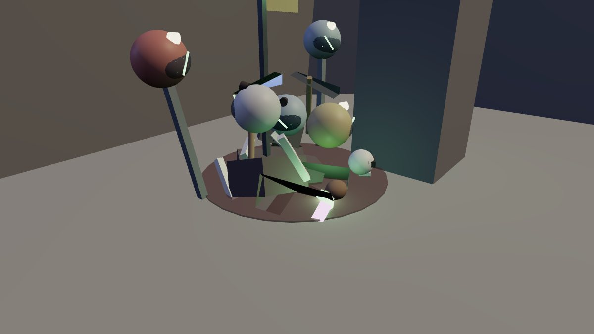

# The Rift: through a Rift Vein's gate into the critters' world

Each of the three Rift Veins in the quarry has a **Rift Gate** over its
dormant tear: a jagged arch of slate with fire at its feet. Walk up to one
and you can go through, into the critters' own world: a walled pathway of
caves open to a burning sky. You go in with your combat kit out and your
kaiju beside you, fight your way through cave by cave against brainrot
critters and the pathway dungeon's fighters that lead them, every one of
them tearing through the floor at you, then face the boss you picked
at the gate, as a Colossus on its throne.

It's built for a party. You can go in alone, but the game warns you first.

The pictures are offline renders of the parts the server builds
(`Server/World/RiftWorld`, `Server/World/OutpostWorld.veinMarks`), drawn by
the trailer renderer. The actors are the game's own models posed at the
game's scales. They are **not Roblox screenshots**. Fire in the game is
Roblox `Fire` particles; the renders stand in a few glowing flame strips
for it, and the sky's ash and lighting are only roughly matched. The UI
shots are the real client code rendered by the UI harness.

## The gate

- **On the moon** (`OutpostWorld.veinMarks`): a scorched bed with glowing
  cracks, a 13-shard arch with neon inner edges and fire at its feet, and
  the vein's tear hanging in it, drawn in the Hell palette (`RiftTear`).
  The guarded vein's cracks are in its own red.
- **Its prompt**: **Enter the Rift** (`ProximityPrompt` on the gate's
  `Heart`, `PromptKind` "Rift", attribute `Vein` = the vein's index).
- **The lobby** (`RiftClient.openGate`), before you go in. It is the
  gate's own lobby: who's going with you, who else is about, and the boss.

  - **The header**: which Rift it is, the gate's biome and its element
    (**RIMEFROST · CRYO RIFT**), in the element's colour, and what's
    through it. **Not now** sits by the title.
  - **YOUR PARTY · n/4**: four places. Each member has their face (their
    Roblox headshot), their name, where they are (**AT THE GATE**, **IN
    THE OUTPOST**, **IN THE RIFT**, **NOT IN THE OUTPOST**, or **AWAY**
    when they're not in this server), **READY** or **NOT READY**, and
    **LEADER** on the leader. You're first and marked **YOU**. An empty
    place says **OPEN** · "Invite from the list". On your own you're the
    only member, ready, and no one is marked leader.
  - **CHOOSE YOUR BOSS**: the biome's ladder as a row of cards (see
    [The ladders](#the-ladders)). Each card has:
    - the boss's portrait: its real body, built once by the server into
      `ReplicatedStorage.RiftPortraits`, shown in a `ViewportFrame` from
      the front quarter;
    - its threat as pips (green, amber, red);
    - its **level** (`LV 13`) and its name;
    - its favourite gear, and how often you've beaten it.

    A locked boss is a dark silhouette marked **LOCKED**, with "Beat
    Tralalero Tralala to unlock". The card opens on the first boss you
    haven't beaten (`RiftRun.nextBoss`). **The leader picks**: in someone
    else's party, clicking a card says "Your party's leader picks the
    boss."
  - **Who's about**, on the right, in two tabs:
    - **IN THE OUTPOST n**: every other miner in the Outpost. Those
      within 30 studs of this gate come first (**At the gate**, in green),
      then your friends, then the rest by name. Each row has their face,
      name, level, where they are and **FRIEND** on a friend.
    - **FRIENDS n**: your Roblox friends online
      (`Player:GetFriendsOnline`, through `Client.SocialUI.friends`).
      Those here come first, then those playing in another server of
      this game (**Playing, another server**), then the rest
      (**Online**).
    - What a row offers: **INVITE** asks a miner here into your party
      (`PartyInvite`; leaders only, while there's room). **INVITE ↗** is
      Roblox's invite to the game, for a friend who isn't here. After a
      click the row says **INVITED** for a while. A miner already in a
      party says **IN A PARTY**, one in the Rift **IN THE RIFT**.
    - **INVITE FRIENDS TO THE GAME** under the list opens Roblox's invite
      window.
  - **The buttons**, by where you stand:

    | You are | The button | What it does |
    | --- | --- | --- |
    | On your own | **ENTER ALONE** | In you go |
    | Leading a party | **ENTER TOGETHER**, or **ENTER · 2 OF 3 READY** while some aren't | In you go, and everyone ready comes with you, wherever they are in the Outpost |
    | In someone's party | **READY** / **NOT READY** and **GO IN NOW** | Tell your leader you're set, or go ahead (they can follow) |
    | Your party's in there already | **JOIN THEM** | Through to wherever they've got to, against their boss (no ladder then) |

    A line under the buttons says the same in a sentence.
  - **Alone against a boss built for 2 to 4** (threat III), a warning box
    with the warning sign: **BRING FRIENDS**. "Frigo Camelo is built for
    2 to 4 of you. You can go in alone, but it won't be easy: invite
    someone from the list." You can still go.
  - **It keeps itself up to date** while it's open: your party
    (`SocialUI.PartyChanged`), your friends (`SocialUI.FriendsChanged`),
    miners joining and leaving, and once a second who's where. It only
    redraws when something changed. It closes by itself when you're taken
    in.

  

  

  

  

  

  On phones the about line and the hint go, the party's places, the
  boss cards and the list are shorter, and the list scrolls:

  

  The pure part (who goes in which place, the rows, their order and what
  each offers) is `Shared.RiftLobby.lobby`, tested in `run_rift`.

- **Crossing**: the screen goes dark red for a moment with **THE RIFT**
  (and the warning again if you're alone), then the lighting turns hellish
  (`RiftClient.Hell`: a low red evening, thick red haze, no stars). Coming
  home puts the Outpost's lighting back.

**Brutus's bounty board** in the Shelter is the same lobby with a tab per
biome: every gate's ladder from one counter. See
[hall-of-fame.md](hall-of-fame.md#brutuss-bounty-booth).

## The ladders

Each biome's gate opens on a Rift of its element, and each Rift has its
own bosses, in order (`RiftRun.Ladders`). The first is built to beat
alone; the last (threat III) is built for 2 to 4 of you. Each opens once
you've beaten the one before it.

| Biome | Its Rift | The ladder (threat, favourite gear) |
|---|---|---|
| Ashfall | Thermal | Bombardiro Drago (I, Helmets) → Tung Tung Tung Sahur (III, Weapons) |
| Rimefrost | Cryo | Paperotti Gemelli (I, Boots) → Tralalero Tralala (II, Shields) → Frigo Camelo (III, Chest Suits) |
| Stormglass | Ion | Chimpanzini Bananini (I, Boots) → Gattini Gemellini (II, Gloves) → Cappuccino Assassino (III, Weapons) |
| Blightwood | Corrosive | Ranocchio Avocadino (I, Shields) → Brr Brr Patapim (III, Helmets) |

- **The threat** sets the boss's level (+0, +4, +8 over the last cave's),
  its health (0.85x, 1x, 1.2x) and its cache (see
  [arena-streaks.md](arena-streaks.md#boss-caches)). With your lead kaiju
  at level 10 the last cave is level 15, so a ladder reads LV 15, LV 19,
  LV 23.
- **Unlocking**: a win counts for everyone still in, joiners too
  (`profile.RiftBosses`, `{ [bossId] = wins }`, saved with the profile).
  The first win over a boss tells you what it opened: "Unlocked:
  Tralalero Tralala, next on this Rift's ladder."
- **Going in** (`RiftEnter`, vein, boss id): the server checks the pick
  (`RiftRun.canFight`). A locked boss: "Beat Paperotti Gemelli first." A
  boss from another biome's ladder: "That boss isn't behind this gate." No
  pick: the next boss you haven't beaten.
- **Alone at threat III** you're let in, and told: "You're in the Rift
  alone, against Frigo Camelo: it's built for 2 to 4 of you. Bring friends
  if you can."
- **Its fighters** (the caves' leaders and the boss's adds) are of the
  Rift's element (`RiftRun.pickFighters`).

## The way

The world is built for each trip, far off in the dark, and gone with it
(`RiftWorld.build`).

- **Its layout** is the pathway dungeon's: the landing, 4 caves, then the
  throne cave, each on a grid cell next to the one before, and the path
  never runs beside itself (`RiftRun.layout`). The first step is always
  straight ahead of the landing.
- **Caves** are 76 studs across (the throne cave 96), floored with basalt
  and glowing cracks, and **walled all round**: rock faces 34 studs high,
  boulders at their feet, jagged crowns, the odd ledge and glowing seam.
  There is nowhere to fall and no lava.
- **Passages** 22 studs wide join them, walled too, under a rock arch with
  fangs.
- **Walls of fire** bar the passage out of each cave until its pack is down.
- **The sky** (`Sky`): a burning scar across it, strands of light, 14
  low clouds lit from below, and ash falling (`Ash`).
- Through the floor somehow (20 studs under it), you're put back in the
  last cave you reached, unhurt.

## The fallen

Crews went in before you and didn't come back. What's left of them lies in
the caves, and more of it round the throne (`Server.World.FallenMiners`,
props only: you walk through them, nothing to press):

| | |
| --- | --- |
|  |  |

- **Each one**: an old expedition suit in one of four faded crew colours,
  the big visor dark and cracked (the crack glowing), the skull behind it
  with its sockets still faintly lit, a headlamp that's sometimes still on,
  its pick, a pouch of gems spilt and glinting (one lights the floor), the
  floor stained dark under it, and crystals of the place grown up through
  it. Three ways they lie:
  - **Slumped** against a wall, head on its chest, the pick across its lap.
  - **Face down**, reaching for the pick it dropped, its helmet rolled off
    (the skull bare), claw marks where something dragged it.
  - **Sprawled** on its back, arms flung out, its pack torn off beside it,
    its pick stood in the floor like a marker.
- **Where**: 2 by the walls of each cave (`Count.Cave`), never in the way
  through; 6 round the throne (`Count.Throne`), clear of the throne, the way
  home and the heap. None on the landing.
- **The heap** beside the throne: rubble, three helmets, bones, a skull,
  two picks stuck in it, a torn crew banner on a pole, two more helmets up
  on spikes either side, gems spilt round its foot, claw marks.
- In the Rift their glow is ember and the claw marks blood red. **The
  pathway dungeon** has them too: one in each room, glowing its element's
  colour, 4 and the heap in the boss's room.

About 27 parts each and 59 for the heap: a trip is 1,261 parts (under the
1,400 the tests allow).

### What drops what

Critters never drop armor. In the Outpost they pay your kaiju EXP and coins
(and a robber carries off your gem). In the Rift and the dungeon, critters
and fighters drop nothing on the way; the boss at the end drops a cache
(its gem and six pieces of gear, keep three), and the Rift pays coins and
kaiju EXP when you clear it. Mining pays gems only. Armor otherwise comes
from the lottery (every roll leaves a piece for the Market) and the Market.

## A trip

The rules are `Shared.RiftRun`; the server is `Server.RiftServer`.

| | |
| --- | --- |
| **Your kit** | Your combat kit comes out as you go through and stays out until you're home (`SparServer.riftKit`: hunting, as in the Outpost). You can't put it away in there: "Your kit stays out in the Rift." |
| **Packs** | Each cave's pack comes up when the first runner walks in, not before. **Every one of it comes through a tear of its own** in the cave's floor, in the critters' world's colours (the Outpost's tears, `RiftTear`, Hell palette): one opens every 0.45 seconds, at least 9 studs from the others and from any runner. The critters come first, leaping out at the nearest runner, then their leaders through taller tears (10 studs). Until the last is through, the pack is on its way: the strip counts it in foes left, and the cave can't clear |
| **Critters** | 3, 4, 4, 5 in caves 1 to 4 (never fewer than a team of three kaiju), plus 1 for each runner past the first. Brainrot critters from the Outpost's roster; a ranged one only at the back |
| **Big ones** | From cave 2, a 60% chance that one of the critters is a **Rift Brute**: 4x health, 1.5x damage, longer reach |
| **Fighters** | The pathway dungeon's regular fighters lead each pack (`Duelist.spawnDungeon`; `RiftLeader` on their models): 1, 1, 2, 2 in caves 1 to 4, plus one for every two runners past the first, armed and armoured to gear tier 1, 2, 2, 3, each with 1.5x a room fighter's health. One of the dungeon's roster per cave, with its element and moves. Anyone in the trip can hit them and be hit by them, kaiju too |
| **Level** | The critters come at your team's level (the average of the runners' lead kaiju), +2 in cave 1, +1 more per cave. The boss's level is the last cave's, +0, +4 or +8 by its threat (I, II, III: `RiftRun.bossLevel`), and its adds come at it. The gate shows it, worked out from your party's lead kaiju, and so does the strip at the throne (**THRONE CAVE · FRIGO CAMELO · LV 17**). Capped at 30 |
| **Caches** | Clear a cave (critters and fighters) and everyone in finds a gem (`RiftCache`, "Found in the Rift"), 12% luckier in cave 1 and 6% more each cave |
| **The boss** | The one you picked at the gate, from its biome's ladder, as the pathway dungeon's **Colossus**: its boss fighter with every one of its moves, gear tier 4 alone or 4 to 5 in a party, and 1.8x a Colossus's health (+50% per extra runner), times its threat's (0.85x, 1x, 1.2x for threat I, II, III: `Shared.BossLoot`). It tears through (a 16-stud tear) when the first runner reaches the throne cave; it's its cave's leader. At 66% and 33% health it calls 3 critters and a tier-3 fighter through, each through a tear of its own |
| **Beaten** | Everyone still in: 300 coins + 40 per cave, a lucky cache, 120 EXP for their kaiju, and swings back on their pick (the dungeon restore). Anyone down gets up. The way home opens and everyone gets a **boss cache** |
| **Its loot** | A boss cache each, no sharing and no rolling against each other: the Arena Cache's roll and pick (see [arena-streaks.md](arena-streaks.md#boss-caches)), headed **RIFT BOSS DEFEATED · THREAT II** and the boss's name. Inside: the boss's gem, free (its element, Tier 4 / Rank III, Ultra Rare from a tier-4 boss and Legendary from a tier-5 one), its threat's free gems of its element, and six pieces of gear to keep three of, two of them the boss's favourite kind. The other three go up on the Market from the **Rift Vault**, with your 25% cut. It opens a few seconds after the kill; LATER keeps it for whenever you like (the **BOSS CACHE READY** button) |
| **Home** | 20 seconds after the kill, everyone still in is home |

Once the boss is down the strip says **BOSS DOWN · HOME IN 0:20**.

### Who takes whom

- **Your kaiju take the critters.** While any critter of the pack is about,
  your kaiju fight only critters, sharing them out (two on one if there
  are more kaiju than critters). Only once the critters are down do they
  turn on the leaders (`KaijuServer`).
- **You take the leader.** Your lock goes for the pack's leader first:
  - the nearest fighter, or the boss, in range and in sight (or hitting
    you), over any nearer critter;
  - once you're on a leader, critters coming nearer don't pull it off;
  - switching or tapping a target in the list still picks whoever you
    like (`TargetLockRules`).
- **The target list** marks them: **LEADER · their name**.

Your kaiju come with you: you keep the Outpost's attribute, so
`KaijuServer` keeps them out and follows you, jumping when you jump. They
fight the critters and the fighters alike. The Outpost's own critters,
stranded check and lobby healing leave you alone while you're in the Rift
(`RiftRun` attribute).

### The HUD

A strip at the top (claims the top slot like the other top bars): pips for
the caves and the throne, where you are, foes left, gems found and how many
are in.

Your kit is out in the Rift, so the **KIT OUT · 1 MINE** bar (`SparKit`) is
up too. It sat in the same spot as the strip and showed through behind it.
Now it sits just under the strip whenever the strip is up (`refreshBar`
reads the strip's bottom edge), on a computer and on a phone:

| Before | Now |
| --- | --- |
|  |  |

### The arrows on the ground

When a cave's wall of fire goes out, the yellow arrows (`GroundGuide`) lead
you through it, a little way into the next cave (the gate's `Into`
attribute, set by `RiftWorld`). Once you're through, they stop. They used to
point at the gate itself for 15 seconds, so after you walked through they
turned round and pointed back the way you came. Once the boss is down they
lead to the way home.

## Going down

Down in the Rift works like down in the Outpost: with your kit out, a
finishing blow knocks you down (`SparDown`), it doesn't kill you. The
fighters leave you be while you're down; with everyone down, they wait.

- **On the way**: you stay down and the critters rob you (`Robbery`,
  `Frontier.Rob`):
  - the cave's critters within 70 studs come for you; if fewer are near
    than there's to take (up to 3), more leap out of Rift tears round you;
  - each grabs one of the gems you found in there, newest first ("A critter
    grabbed your Thermal Gem!"), holds it up and runs for a tear with it.
    Knock it out before it gets there and it drops the gem back to you
    ("Recovered."); the ones that get away are gone, and count as down for
    the cave;
  - your screen says **KNOCKED OUT · The critters are going through your
    pouch! · Back to base in 8**;
  - after 8 seconds (sooner once there's nothing left to take), you're back
    at base on your feet, and a card tells you what they took.

  The card (`RobReport`): **ROBBED!**, each gem they grabbed in 3D with its
  name in its rarity's colour and **GONE**, or **SAVED** if you knocked it
  loose again. With nothing on you to take: **NOTHING TAKEN**.
- **At the boss**: you stay down and choose.

  - **RESTORE · 150 COINS**: you and your kaiju, every one of them, back to
    full health right there (`KaijuServer.restoreAll`). It doubles each
    time in a trip (150, 300, 600...). Coins only, no Robux;
  - **INVITE A FRIEND**: the invite window, while you wait;
  - **BACK TO BASE**: home with the gems you found;
  - nothing chosen in 60 seconds: back to base.

  Your kaiju fight on without you while you're down.

## Healing crystals

Green crystals grow in the corners of every cave and the throne cave, 2 a
cave (`RiftRun.Heal`, `RiftRun.healSpots`, `RiftWorld.healRock`). They're
for healing, not gems:

- Their label reads **HEALING CRYSTAL**, their prompt **Click to heal**.
- Swap to your pick (**1**, or the kit button on phones) and mine one:
  each swing heals you 7%; the swing that breaks it (5 swings) heals you
  25% more and your kaiju that are up 35% ("The crystal breaks open: you
  and your kaiju feel stronger."). It grows back in 40 seconds.
- Not while you're down, and only from 10 studs.

## Your kit and your pick

Your combat kit is out when you go in, but you can put it away: **1** on a
keyboard, or the **FIGHT / MINE** button on phones (at the bottom, left of
the middle, where it sits beside PLAY in the Outpost), swaps between your kit and your pick, here and in the Outpost alike
(`SparKit.toggle`, the server's `Hunt`). Not while you're down.

## Together

- Up to 4 in a trip. Party members can join through **any** gate while the
  trip is still on the way (not once it's at the boss).
- **Going in together.** The leader's **ENTER TOGETHER** (`RiftEnter`
  with `together`) takes every member who's ready in with them, from
  anywhere in the Outpost, up to 4 (they get the same **THE RIFT**
  crossing on their screen). A member who isn't ready, or can't go
  in just now, is told "Marc went through a Rift Gate: walk up to any
  gate to follow." A member's own **GO IN NOW** takes nobody in with
  them.
- The pack sizes, the fighters and the boss's health grow with each
  runner.
- While you're in the Rift, nothing else can start for you: spars, kaiju
  battles, duels and the duel queue, raids and the dungeon queue, the
  Arena and expeditions all answer "Leave the Rift first." or "Sam is in
  the Rift." (It would pull you out mid-trip.) Going in ends a spar you
  were in ("Sam went into the Rift.").

## Leaving

- **The way you came in**: the landing's opening (prompt **Go home**),
  keeping what you found.
- **The way home** in the throne cave opens once the boss is down.
- Leaving the game ends your trip.
- Your kit goes away when you're home.

## Where it lives

| File | What |
| --- | --- |
| `src/shared/RiftRun.luau` | The rules: the layout, packs and fighters, where their tears open (`Portal`, `portalSpots`), levels, the boss and its health, caches, rewards, robbery, RESTORE's price |
| `src/shared/BossLoot.luau` | Each boss's cache by its threat (free gems, Ultra Rare gear, quality, health), its favourite kind of gear |
| `src/server/World/RiftWorld.luau` | Builds a trip's world far off in the dark: walled caves, passages under arches, walls of fire, the throne cave, the ways home, the burning sky; `RiftWorld.inside` (is a spot in a cave) |
| `src/server/World/FallenMiners.luau` | The fallen: `place` (one, in a pose), `heap` (by the boss), `scatter` (round a room, by the walls first, clear of the doors and of what it's told to avoid), `Count`; the dungeon's rooms use it too (`DungeonWorld`) |
| `src/server/Systems/RiftServer.luau` | Runs trips: `RiftEnter` (going in together: the ready members with their leader), `RiftLeave`, `RiftChoice`, `RiftPeek`; a boss cache each at the kill |
| `src/server/Systems/ArenaStreaks.luau` | `ArenaStreaks.bossCache`: rolls and saves a boss cache, and tells its owner |
| `src/server/Systems/KaijuServer.luau` | Your kaiju take the critters before the leaders |
| `src/shared/TargetLockRules.luau`, `src/client/Modules/TargetLock.luau` | Your lock takes the leader first |
| `src/client/Modules/FoeBars.luau` | **LEADER** in the target list |
| `src/server/Systems/FrontierServer.luau` | The tears (`open`: `Height`, `Hell`), through `KaijuWilds.rift` |
| `src/server/Systems/Duelist.luau` | The fighters and the Colossus (`spawnDungeon` with a Rift encounter: its runners are whoever's in the trip, kaiju can fight them, `HealthScale`) |
| `src/server/Systems/Dungeons.luau` | `Dungeons.bossGem`: the boss's gem, shared with the pathway dungeon |
| `src/server/Systems/SparServer.luau` | `SparServer.riftKit`: the kit out going in, away coming home |
| `src/client/Modules/RiftClient.luau` | The gate's lobby, the crossing, hell lighting, the strip, the down window |
| `src/shared/RiftLobby.luau` | The lobby's rules: the party's places, who's about and in what order, what each row offers |
| `src/client/Modules/SocialUI.luau` | Your party (`party`, `PartyChanged`), your friends online (`friends`, `FriendsChanged`), Roblox's invite (`inviteFriends`) |
| `src/client/Modules/StreakRewards.luau` | The cache screen: the roll, the picks, CLAIM (a boss cache's heading, threat and element) |
| `src/server/World/OutpostWorld.luau` | The gate on each vein (`veinMarks`) |
| `src/client/Modules/RiftTear.luau` | The tear in the gate, in the Hell palette |
| `src/server/Systems/KaijuWilds.luau` | `spawnBug` options for the Rift's critters (`Scale`, `Health`, `Damage`, `Reach`, `Title`, `Stay`, `Wander`) |

A runner carries `RiftRun`, `RiftRoom`, `RiftLeft`, `RiftBoss`,
`RiftBossLevel`, `RiftFound`, `RiftRunners`, `RiftWon`, `RiftExitAt`; when down at the boss
`RiftFallen` and `RiftRestore`. A boss cache is saved with the player's
Arena Caches (`profile.Duel.StreakCaches`, `Kind = "Boss"`).

## Spanish

Every line above is in `Shared.LangEs`: the lobby (its places, tabs, rows,
buttons and hints), the warning, the strip,
the down window, the boss cache, the server's messages and the prompts.
Boss and move names stay in English (they're names).

## Tests

| Suite | What it checks |
| --- | --- |
| `run_rift` | 34,079 checks: the gate's lobby (on your own; the Outpost's rows in order and what each offers; your friends here, elsewhere in the game and online; INVITED; a member's party and a full one; your party already in there); the ladders (every boss on one ladder of its element, threats rising, the first built for one and the last for 2 to 4, locks, the next boss, levels rising and capped, fighters of the Rift's element), pack sizes (never fewer critters than a team of kaiju), where the tears open (spread, clear of the runners, on the cave's floor, one for each even when crowded), fighters and their gear, levels, the elite, every boss picked over many draws and each with its moves, the boss's gear tier and health, each boss's threat and favourite gear (its health and cache by threat), adds, caches, rewards, robbery, RESTORE's price, the solo warning, the layout. The world over many trips: walled caves you can't walk out of, floor all the way, arches you fit under, walls of fire at the passages that open (each leading a little way into the next cave), the ways home, no lava, the sky, parts per trip (1,261). The fallen: 2 in each cave and more round the throne, none on the landing, the heap by the throne, every part one you walk through, none in the way through or the way home, a pose each; scattered alone, by the walls first, clear of what to avoid and of the doorway; in a dungeon, one a room, more and the heap in the boss's. And nothing else starts for a runner |
| `run_kaiju` (`kaiju_server_cases`) | Whole trips on the server: going in with the kit out, packs coming up as you walk in, each foe through a tear of its own (critters first, leaders through taller ones, spread out, a moment apart, in the Rift's colours), counted on the strip while on their way and the cave not clearing before they're through, the leaders marked, your kaiju taking critters before a leader and the leader once they're gone, the boss through its own tear and its adds through theirs, a wall opening, caches, the floor, robbery on the way, the Colossus and its adds, down at the boss, RESTORE, BACK TO BASE, joining a party, winning, a boss cache each (the boss's gem in it, Legendary from a tier-5 boss; alone or in a party; no claim, roll or pass), the clock home starting at the kill, the kit away at home. The ladder: the gate's peek (its biome's element, the ladder, the next boss, each boss's level at your kaiju's and rising, locks, a portrait each), a locked boss, an unknown one and another biome's refused, the gate's first boss and its element's fighters, a joiner seeing the party's boss, a win tallied for everyone and the next boss unlocked and offered, the top boss alone allowed and warned. Going in together: a ready member brought in from far off, one not ready told they can follow, a member going in bringing nobody. The fighters are stand-ins here: the real Duelist isn't loaded |
| `run_target_lock` | Your lock takes a pack's leader over nearer critters and those attacking you, holds it against them, takes it back from a critter, but not hidden or out of range; a target you pick still holds |
| `run_spar` | Going into the Rift ends a spar, the kit stays out in there and can't be put away, nobody spars with a runner, and the kit goes away at home |
| `run_outpost` | Each vein has its gate, prompt, arch, glow, cracks in its colour and its index |
| `run_lang` | The gate in Spanish: the lobby's lines, its biome and element, the ladder's heading and lines, a locked card, BRING FRIENDS and its warning, an unlock, joining your party, the strip's level |
| `run_topbar` | The crossing is a cover; the card, strip and down window keep clear of Roblox's buttons |
