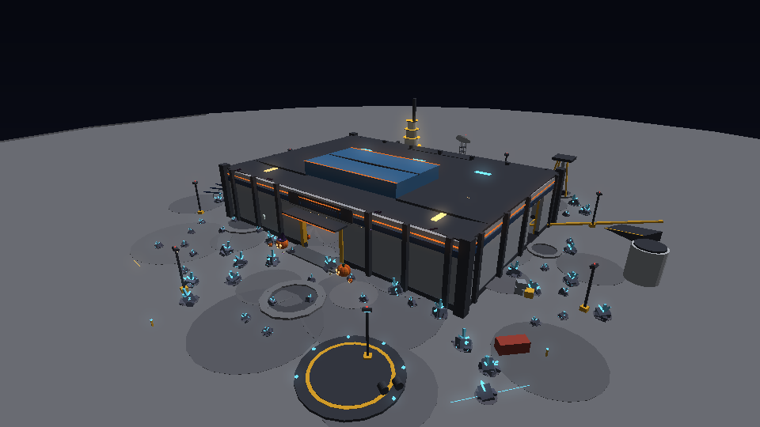
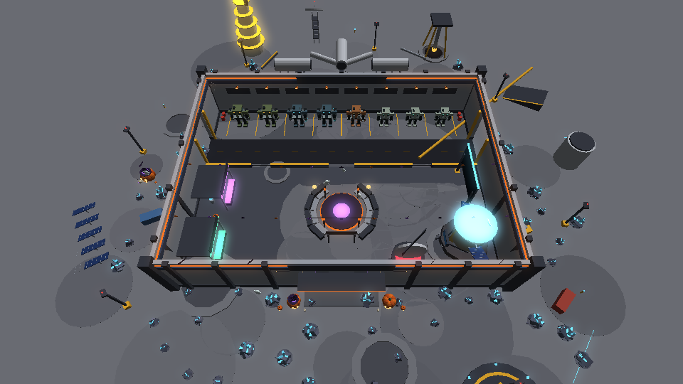
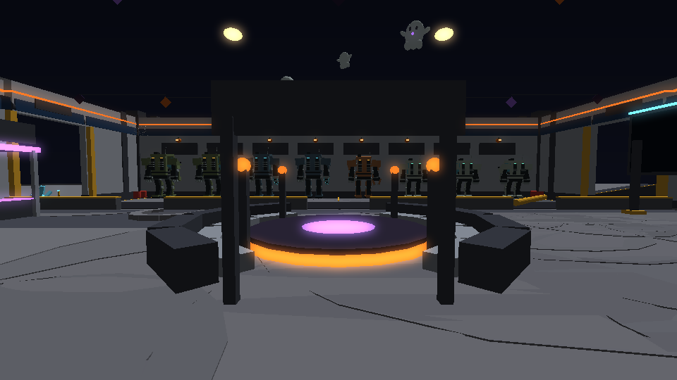
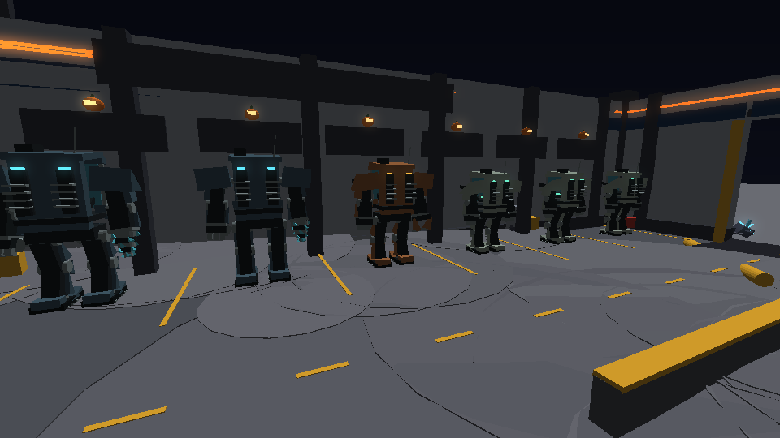
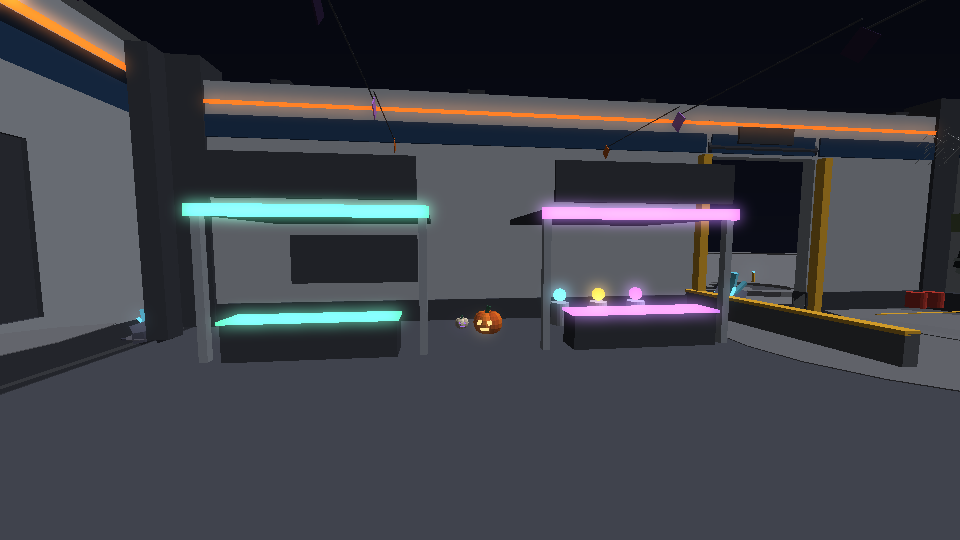
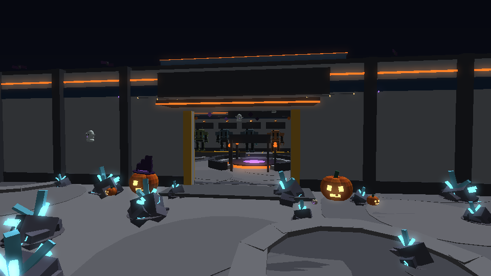

# The Shelter: the Outpost's base (2026-10-19)

The Outpost keeps its crater basin, but in the middle now stands the
**Shelter**, a big base that holds the lobby. Players arrive inside it.
Everything social and every shop is under its roof, and **outside is
where you mine and kite critters**. It is built by the server with the
rest of the world (`OutpostWorld`, the `shelter` builder).

*(Offline renders from the game's own geometry, flat-shaded, with no
Roblox lighting. Sign text (SurfaceGuis) isn't drawn in them.)*

## Size

168 by 120 studs inside, walls 34 high (an orange glow band and a row of
windows near the top), and a raised glass skylight over the hall (about 44
at its peak). Ribs run up the outside, with heavier corners.

## Inside

| Where | What |
| --- | --- |
| North | **Mech garage**: eight bays in a row along the north wall (BAY 1-8, each mech's name on its sign and a jack-o'-lantern over it), every mech facing the lane. The lane runs the full width to a **big door at each end** (east and west, 26 high, EXIT over them, hazard posts, the roller door rolled up). A barrier with three gaps keeps the hall clear. |
| Middle | **Kaiju arena**: a stage edged in glow, two tiers of stands open to the door and the garage, pylons, and its sign (KAIJU ARENA, COMING SOON). The battles are still to be worked out. |
| West wall | **STORE** booth (opens the Store) and **MARKET** booth (opens the player Market), each a counter with a prompt, a canopy and a lit sign. The Store shows what it sells on stands: helmets, weapon skins and pickaxes behind the counter, suits on turntables either side ([the Store's stands](probe-store-crew-quarry.md#the-stores-stands)). |
| East wall | **PROBE-7** (the swing refills Exchange), the probe that landed and unfolded into the station ([PROBE-7](probe-store-crew-quarry.md#probe-7-the-probe-that-became-the-station)), and the **leaderboard**. |
| By the door | The **1V1 ARENA UPLINK** (duels, "win streaks restore your swings": see [swing-restores.md](swing-restores.md)) and **HOW IT WORKS** on the wall: mine outside, win 1v1s for swings, heal your kaiju once you're clear, mechs in the garage, invite friends for coupons. |
| Over the door, inside | **TO THE QUARRY**: mine rocks, kite critters, catch kaiju. |

Since then the hall has gained the Moon Garden (west), the Gem Gallery
(east), a kaiju hologram on the arena's stage, a tiled floor and more
light: see [lobby-polish.md](lobby-polish.md). The old town's shopkeepers
now work here too (Ilsa buys gems at the Gem Gallery; Brutus, Tamsin,
Borin and Garrick by their stations): see
[probe-store-crew-quarry.md](probe-store-crew-quarry.md#the-crew).

In the [serious round](fob-serious.md) (2026-10-20) the booths became shopfronts, the Moon Garden the survey table, every sign one system, and the Halloween dressing moved outside.

- **Arriving**: players spawn just inside the main door, facing into the
  hall (`site.Spawn`).
- **Out the door**: one wide door south (28 wide), an apron, and the
  **welcome rocks** right outside in two clusters flanking a clear lane.
  The haul roads now start at the walls (104 studs out).
- **Mechs** drive out of either garage door. They park back in their bays
  (`site.Parking`); the old Motor Pool is gone.
- **Lights**: three over the garage, four along the hall, two hung over the
  arena from the skylight, plus the signs' own glow.
- **Collisions**: floor, walls, roof, the counters, the barrier and the
  arena are solid. Rocks don't grow in or right against it (its box), and
  wild kaiju keep out (circles over its floor in `KeepOut`).

## Halloween

The old welcome-field decorations were reused: giant carved pumpkins by
the door (one wearing the witch's hat), little and pearl ones, string
lights along the front, bats on the roof edge, and a ghost. Inside there are
ghosts over the arena, bunting across the hall, jack-o'-lanterns over every
bay, pumpkins by the booths and the door, and a web in the garage corner.
Three pumpkin patches stay out in the quarry. The Christmas tree corner is
gone.

## Moved to make room

The landing pad and shuttle are now south-east (72, 118). The solar array
moved west (-150, 40), the fuel tanks east (150, -20, clear of the garage's
east door), and the containers and crates that stood where the Shelter is
were taken out. The scene stays under its part budget (3,833 of 4,000;
3,944 since the lobby was filled in, see [lobby-polish.md](lobby-polish.md)).

## Files

- `src/server/World/OutpostWorld.luau`: `shelter` (the building and its
  places), the Halloween pieces (`pumpkin`, `lantern`, `witchHat`, `ghost`,
  `bat`, `web`, `stringLights`, `bunting`, `harvestPatches`), and `build`
  (the spawn, stations, keep-outs and welcome rocks).
- `OutpostServer`: prompts on the Store and Market counters (`PromptKind`
  `Store`, `Market`). `OutpostScene` opens the Store and the Market from them.
- Tests: `run_moon_quarry_scene.py` (spawn inside, services and stations
  under the roof, bays in the garage facing the lane, no rock in the
  Shelter, roads from its walls, the part budget) and `outpost_cases`
  (station prompts, spawn and bays).
