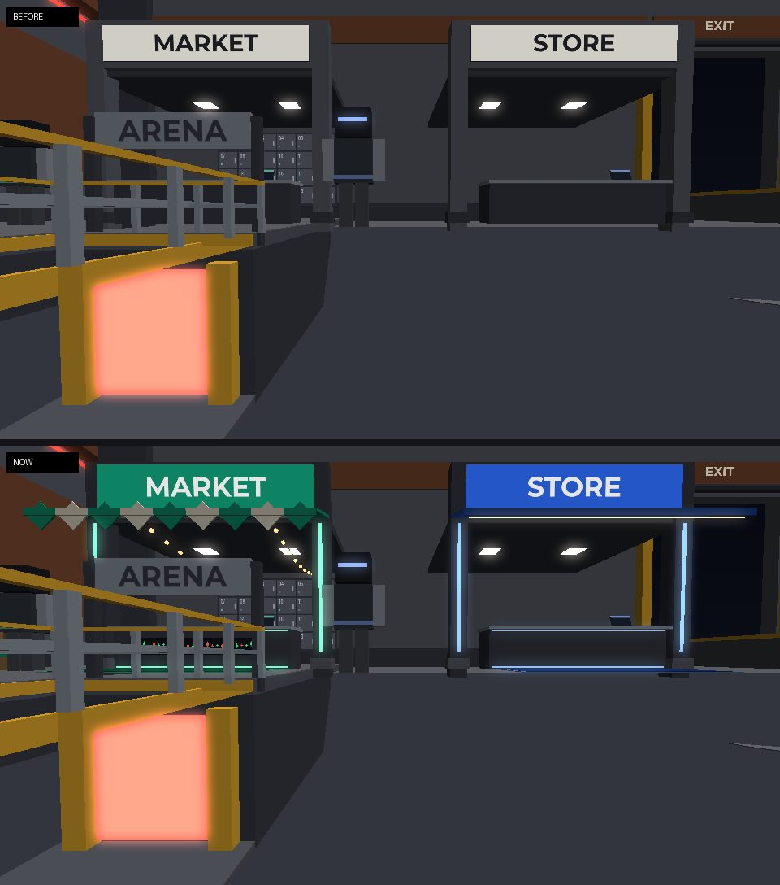
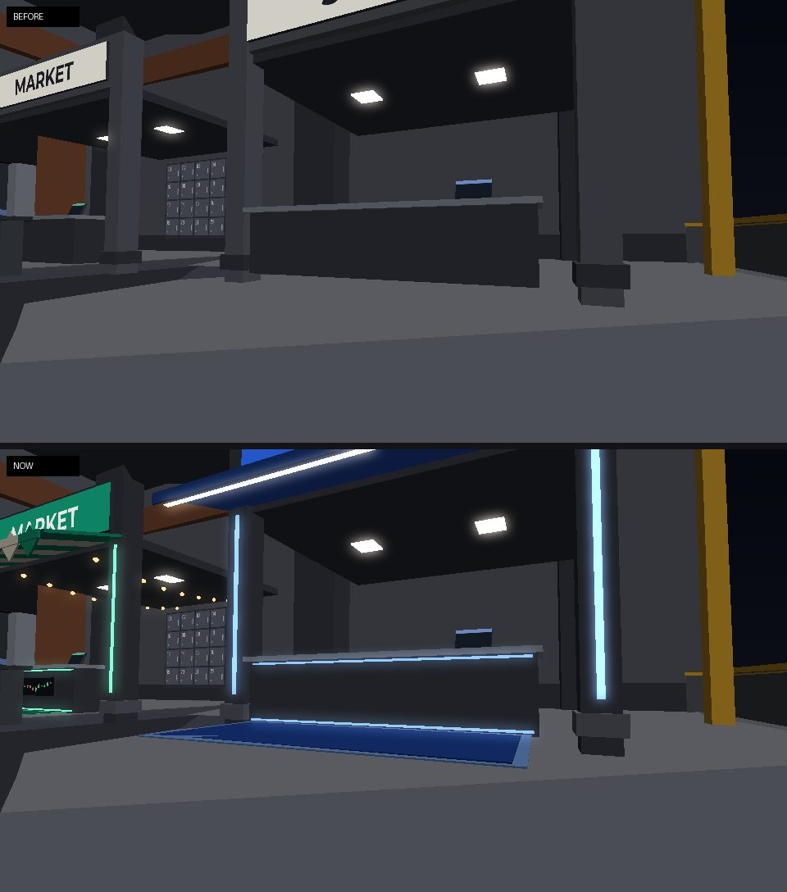
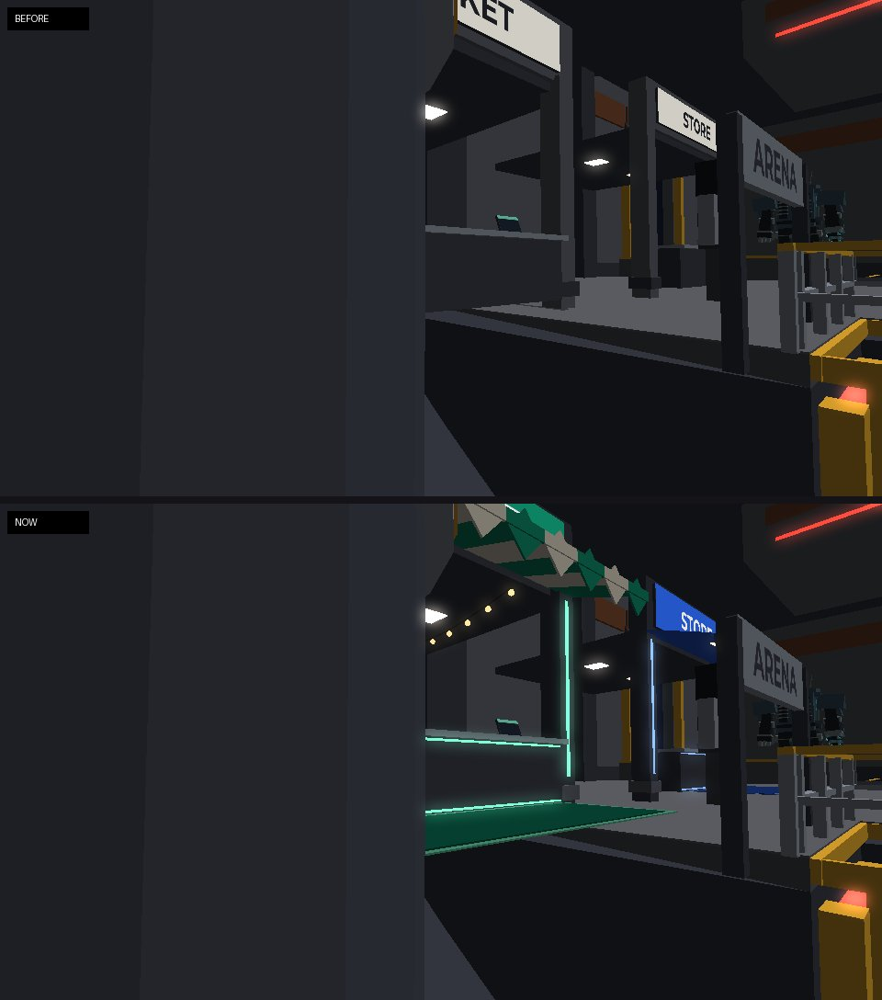

# The Store and the Market: lit shopfronts

2026-10-27. The two shopfronts on the Shelter's west wall were plain grey
alcoves with an off-white lightbox. Each is now lit in its own colour, so
you can tell them apart from across the hall (`OutpostWorld`'s
`storefront`, `SHOP`).

The renders below are offline stand-ins built from the game's own parts and
sign GUIs, not Roblox screenshots. The Store's stands (suits, helmets,
skins, picks) are drawn by each client (`Client.StoreDisplays`) and aren't
in them.

## Both

- **The lightbox** is lit in the shop's colour (the Store cobalt, the
  Market green) with its one word in white. It throws that colour onto the
  front (a SurfaceLight). It still says only STORE or MARKET (the
  [plain signs](plain-signs.md) rule).
- **The columns** are dark, with a strip of the shop's colour lit down each
  face.
- **The counter** has a lit line along its foot and under its steel top.
- **A mat** in the shop's colour lies on the floor in front.
- **A canopy** slopes out over the counter from under the sign.

## The Store

- A plain cobalt canopy with a warm strip lit along under its lip.
- Its back wall (the client's display wall) is deep blue, framed in the
  Store's lit blue, and the helmets' shelf is lit along its edge.

## The Market

- A stall's canopy: green and cream stripes with a pennant under each.
- Nothing on the counter's front but its two lit strips: the board of
  green and red candles that was on it is gone (*2026-10-27*).
- Two strings of warm bulbs under its ceiling, front to back.
- Three crates of gear by its south corner, near Tamsin, banded in the
  Market's green.

Tested in `tests/signage_cases.luau`:

- both lightboxes are lit in a colour of their own, with a white word;
- no candle board (`PriceBoard`) on the Market's counter.
