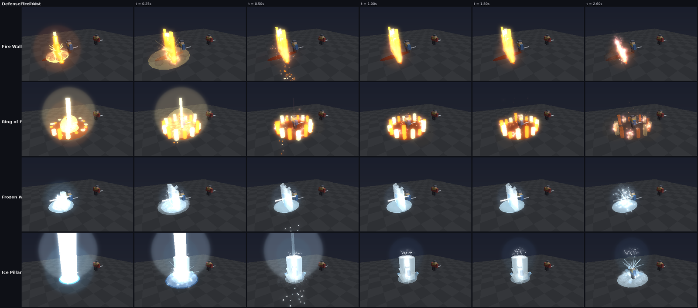
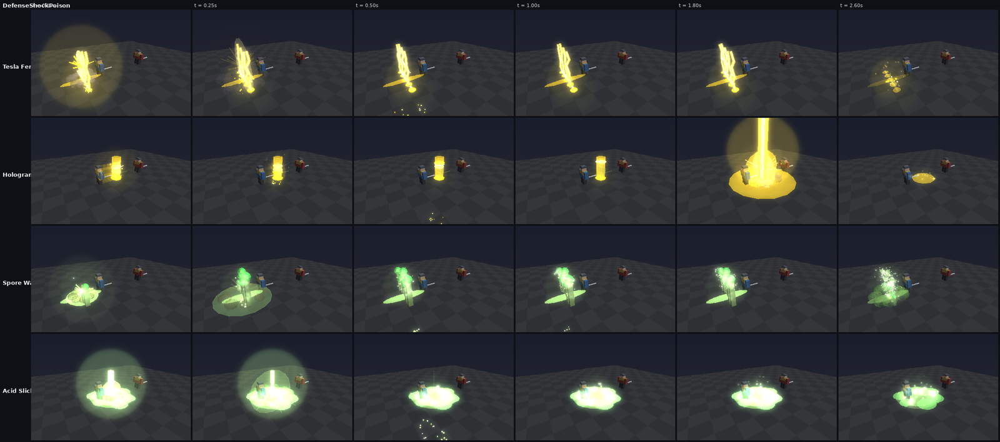
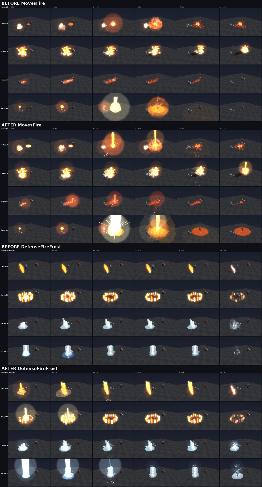

# The showcase starter kit (2026-10-13)

A new player picks a style and an element. Each of Q, E and R is then rolled
from two showcase moves of that element (`GemTraits.Intro`). These are the
flashy moves; for now, the intro picks them for looks and fun, not for depth.
R is never a shield. It is a wall, or a move that changes the ground around
you. Shields still exist as R moves on gems mined later.

The picker shows each element and its strengths: what its hits do, what it
beats and what beats it. It never shows the moves. Those stay a surprise
until the roll.

*Changed 2026-10-23:* there's no CONTINUE button. Tapping a style card
picks it and, a beat later (0.45 seconds), opens the elements; tapping an
element picks it and, a beat later, sends the kit and starts the roll.
"‹ Back to styles" in that beat cancels it. The gold button only comes back
as RETRY THE LAUNCH when sending the kit fails, and for a saved kit
(EQUIP & FIGHT), whose cards can't be changed.

| Style | Element | The roll: each card's circle is a reel that lands on your gem, which gives up its surge |
| --- | --- | --- |
|  |  |  |

The roll's reels are real 3D gems of your element, each on a glow of its
rarity's colour, rolling past at the real gem odds (`GemRoller`: Common 40,
Uncommon 25, Rare 20, Ultra Rare 10, Legendary 5). The window's edge and the
name under it take the colour of the gem going past. Where it stops, your
gem, is the server's roll. Only the gems in a window are 3D: each reel keeps
a few models per rarity and passes them along (a gem is about a hundred
parts). The window is a clipped frame, not a CanvasGroup, because 3D views
don't draw inside one; that is also why its corners are rounded rather than
a circle.

Once the last gem gives up its surge, the kit is locked in. The gem roll
has no button of its own: "NEXT · YOUR KAIJU" shows with a bar filling
under it, and after 2 seconds (or at once on a click) it goes on to the
kaiju roll, which moves on by itself too (see [kaiju.md](kaiju.md)): the
intro has no buttons to press from the first card to the first fight. There used to be a "TO THE FIGHT"
button here, from before the kaiju roll came after the gems.

Behind the cards is the arena you're heading to, in your element's colour:
the stands in rings round a lit floor, two spotlights and a few stars. The
strip under Roblox's top bar is dark too, all through the launch screens (it
used to show the sky, and a planet in it).

(This picture predates the kaiju roll. Under the cards there is now the
gold "NEXT · YOUR KAIJU" line with its bar, not a button.)

## The pools

| Element | Q (sword) | E (chest) | R (shield) |
| --- | --- | --- | --- |
| Thermal | ***Meteor Leap*** / Magma Fault | Supernova / ***Flame Tornado*** | Fire Wall / **Ring of Fire** |
| Cryo | ***Frost Chakram*** / Permafrost Spire | Absolute Zero / ***Hailstorm*** | Frozen Wall / **Ice Pillar** |
| Ion | ***Thunder Dash*** / ***Skybreaker*** | ***Storm Call*** / ***Ion Cannon*** | **Tesla Fence** / **Hologram Decoy** |
| Corrosive | ***Viper Lash*** / ***Toxic Flask*** | ***Toxic Tide*** / ***Maneater*** | **Spore Wall** / **Acid Slick** |

(*Bold italic*: the starter Q and E moves added on 2026-10-14, below.)

Each element has two R moves: one **barrier** and one **escape**
(`GemTraits.Showcase`).

## The six new R moves (in bold above)

| Move | What it does |
| --- | --- |
| Ring of Fire | A ring of flame circles you for 4s. Foes who cross it burn and get thrown back. |
| Ice Pillar | An ice column lifts you out of sword reach for 2.5s, then shatters and slows everyone nearby. |
| Tesla Fence | A curtain of lightning bolts striking down, with arcs jumping between them. It stops bolts, and foes who walk through are stunned. |
| Hologram Decoy | You blink back and leave a flickering copy of yourself. It explodes in lightning when a foe gets close. |
| Spore Wall | A hedge of toadstools. It stops bolts and poisons foes who walk through. |
| Acid Slick | A bubbling acid pool. Foes standing in it are slowed and their armor is shredded. |

They are part of the full catalog: the matrix now has 66 moves, up from 60.
Gems mined later can roll them too.

## What it replaced

- **Before:** every starter kit got fixed moves: Offense #2, Ability #1 and
  Defense #1 of its element's matrix. For three of the four elements, R was a
  shield.
- **Now:** `StarterLottery.prepareChoice` rolls each key from its pool on
  the server and saves the result as `reward.Moves` (kit `Version = 4`).
  Retrying never re-rolls the kit.
- **To go back to fixed moves:** in `src/shared/GemTraits.luau`, give each
  `GemTraits.Intro[element]` lane a one-item list.

## The starter Q and E moves (2026-10-14)

Ion and Corrosive felt flat. Their moves were built around crowds (Chain
Lightning and Circuit Cleave do nothing extra against one foe) or around
numbers you can't see ("takes 20% more damage"). Cryo Stream, a held beam,
was dull. Twelve new moves replace them, and the four kept (Magma Fault,
Supernova, Permafrost Spire, Absolute Zero) got their own looks too.

**The rule:** every starter move pays off against a single opponent, and you
can see what it did. Each has its own look (`src/client/Modules/MoveVfx.luau`),
a flash and shockwave, a camera shake when it's close, its sound, and for
some a wind-up you can see (a bolt onto your raised blade, a cannon charging).

| Move | Key | What it does |
| --- | --- | --- |
| Meteor Leap | Thermal Q | Leap up to 14 studs and crash down: 150% around you, foes thrown back, a burning crater for 3s. |
| Flame Tornado | Thermal E | A fire tornado tears across 22 studs, dragging foes along and scorching them, then bursts at 90%. |
| Frost Chakram | Cryo Q | A spinning ice blade flies out 16 studs and back: 85% each way, and every hit Chills (3 freeze). |
| Hailstorm | Cryo E | Hail on an area for 3s: 24% every half second; stay 2s and you're frozen solid. |
| Thunder Dash | Ion Q | Become lightning and flash 13 studs through your foe: 130% and a stun, leaving a crackling trail. |
| Skybreaker | Ion Q | A bolt from the sky onto your foe: 170% and stunned 0.7s. |
| Storm Call | Ion E | 5 bolts hunt the foe nearest the storm, each marked just before it lands (dodgeable); the last stuns. |
| Ion Cannon | Ion E | Charge, then a body-wide beam through a 45-stud line: 230% and blown back. |
| Viper Lash | Corrosive Q | A venom whip snaps out 16 studs and drags the foe to you: 90%, poisoned and slowed. |
| Toxic Flask | Corrosive Q | Lob a flask: it bursts for 120% and poison, leaving an acid pool that slows. |
| Toxic Tide | Corrosive E | A wave of acid rolls 24 studs: 140%, poisoned, carried along, taking 15% more damage for 4s. |
| Maneater | Corrosive E | A giant flytrap bursts up under the foe and snaps shut: 160%, held 1.3s, deeply poisoned. |

Rendered from the game's own effect code (`tools/vfx_sim.luau` and
`tools/vfx_render.py`, scenarios `MovesFire`, `MovesFrost`, `MovesShock`
and `MovesPoison`; these are offline stand-ins drawn from the effect parts,
not Roblox screenshots):

## The first impression (2026-10-23)

Whatever element a new player picks, their first three moves have to look
like the best thing in the game. Every one of the 24 starter moves (the Q,
E and R of all four elements) was rebuilt on a shared spectacle kit,
`MoveVfx.fx`, which both `MoveVfx` (Q and E) and `TriadVfx` (R) draw from:

| Piece | What it is |
| --- | --- |
| `rays` | Spokes of light bursting from a point, flat along the ground or up and out. |
| `motes` | Glowing motes thrown out of a point that fall under their own weight: embers, sparks, drops, ice. |
| `column` | A column of light that shoots up from a point and thins away. |
| `dust` | Dust, smoke or mist rolling out along the ground. |
| `halo` | A ring that swells and fades, flat or stood up (a thunderclap, a splash, a muzzle ring). |
| `linger` | What a big hit leaves: a glowing, pulsing, lit plate with motes drifting up off it. |
| `ghosts` | Afterimages of a body along a line (a dash, a blink). |

Each big moment now has a wind-up, a flash, the thing itself, a shockwave
or halo, debris, dust, a camera shake near you, and something left on the
ground. What each move gained:

| Move | Now |
| --- | --- |
| Meteor Leap | A comet tail hangs in the air behind the jump; the landing throws a column of fire into the sky, rays, embers, three shockwaves and rolling dust. |
| Magma Fault | A white-hot seam races along the line ahead of the spikes, lava fountains off it, and the far end blows open in a magma geyser that keeps glowing. |
| Supernova | Rings of light are pulled into the sun as it charges; it goes off in rays to the horizon, two crossed halos, a column of fire, and leaves the ground burning. |
| Flame Tornado | A flare at its crown, rings of heat rolling up the column, embers flung from its skirt; it blows apart in a column of flame. |
| Frost Chakram | Ghost blades hang in the air behind it; it turns in a flash and a burst of shards; frost rings where it comes home. |
| Permafrost Spire | Frost cracks race out first, then the spike erupts in a column of cold light, rays and snow; it shatters in a second burst. |
| Hailstorm | Wind whips round under the cloud, which flickers from inside; big stones land in a flash and leave frost patches. |
| Absolute Zero | A flash of cold with two crossed halos and a column of light; snow falls inside the dome; it shatters in rays and a blizzard of shards. |
| Thunder Dash | Afterimages along the line, a scorched streak that crackles, a thunderclap halo and rays where you land, static jumping off you after. |
| Skybreaker | The sky lights up as the bolt comes; two thunder halos, rays, sparks, dust; the ground is left live with arcs for a moment. |
| Storm Call | A funnel of wind under the cloud, rain driving down, the cloud flashing from inside; the last bolt lands in a column of light. |
| Ion Cannon | A muzzle ring blown back off the barrel, dust blown out along the ground under the beam, the ground scorched along the line, a blast at the far end. |
| Viper Lash | A flicking tongue, a bite that spits venom in rays and drops, acid smeared along the ground as it drags them in. |
| Toxic Flask | The flask bubbles in your hand; it bursts in rays and a geyser, and a cloud of poison vapour boils up and spreads. |
| Toxic Tide | It rises in a splash, spray flies off the crest the whole way, and it breaks in a burst of foam, rays and mist. |
| Maneater | Vines whip up round it as it bursts out; the snap spits spores in a cloud, with rays and a halo; the ground stays poisoned. |
| Fire Wall | Ignites from the middle outward, each column a tall licking tongue with a white heart, embers streaming up, heat rays, the line glowing; it falls in on itself. |
| Ring of Fire | The flames light one after another round the ring, under a column of light and heat rays; heat shimmers inside it. |
| Frozen Wall | Rises in a frost shockwave with rays, snow and shards, icicle tips along the top, lit from inside; it shatters in rays. |
| Ice Pillar | A column of light with rays and a frost halo as it rises, snow drifting off it; it shatters in a flash, rays and shards. |
| Tesla Fence | A thunderclap halo and rays on ignition, charge humming along the ground between the bolts, sparks on the way out. |
| Hologram Decoy | The blink leaves afterimages and a halo; the copy materialises in a projector beam with scan rings climbing it; the pop is a column of light, crossed halos and rays. |
| Spore Wall | Bigger spotted caps that puff spores as they open, a toxic mist drifting through the hedge, rays and a halo; it bursts in spores. |
| Acid Slick | Spills in a geyser with rays and drops, vapour rising off it lit from below. |

Each Q and E also has a wind-up you can see while it's cast
(`MoveVfx.cast`): cracks glowing under your feet for Magma Fault, frost
spiralling into a point for Absolute Zero, static jumping off you for
Thunder Dash, vines writhing at your feet for Maneater, and so on.

The R moves render from the new scenarios `DefenseFireFrost` and
`DefenseShockPoison`:

Before and after, for Thermal and the Thermal / Cryo defenses:

`tests/triad_cases.luau` holds the line: every starter Q and E has a
wind-up, and every starter move's drawing uses at least three pieces of
the kit.

**Where they live**

- **Moves:** `src/shared/GemTraits.luau` (the matrix grows to 78 moves). The
  new moves can also roll on mined gems.
- **Mechanics:** `src/server/Systems/TriadServer.luau` adds leaps (Pounce),
  moving storms (Vortex, Disc, Wave), area weather (Hail, Storm), thrown
  payloads (Lob), and pushes and pulls.
- **Existing saves:** starter stones that still carry an old intro move get its
  replacement in the same lane when the profile loads
  (`GemTraits.upgradeStarterProfile`). Mined stones keep what they rolled.
  Gems with no saved roll keep picking from the old lanes (`SeedLength`), so
  nobody's moves change under them.

**Icons:** twelve new icons are painted in `tools/make_ability_icons.py`, so
`assets/images/ability_icons.png` now holds 59 icons on one 1024 x 1024 sheet.

To show them in game, upload `assets/images/ability_icons.png` (Creator Hub,
Images). Then, in `src/client/Modules/SurgeIcons.luau`, set `ImageId` to the
new id, `Layout = "Sheet"` and `Uploaded = 59`. Until then each new move
shows the closest older icon (`SurgeIcons.Fallback`).
