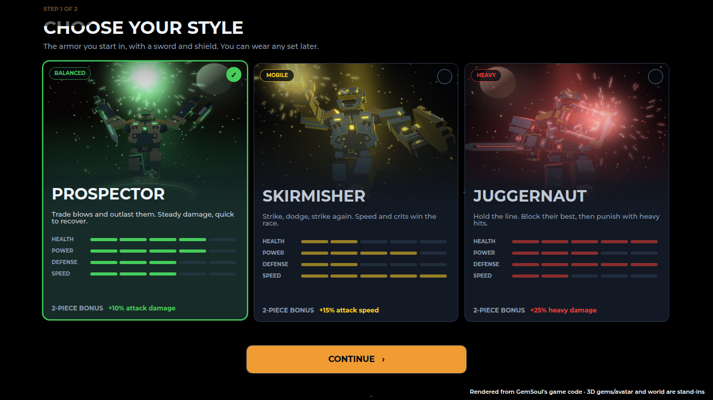
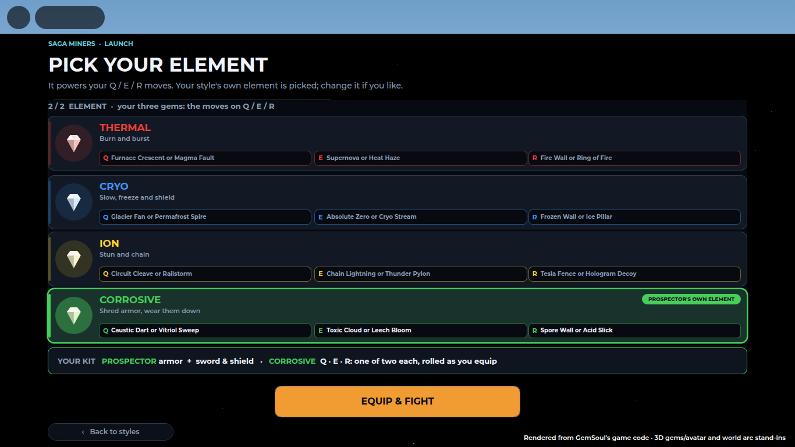
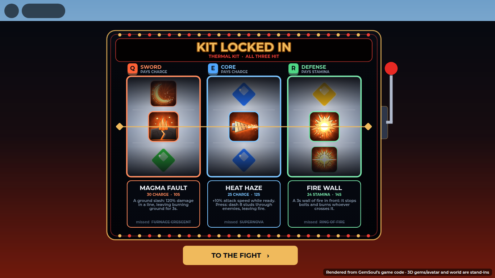
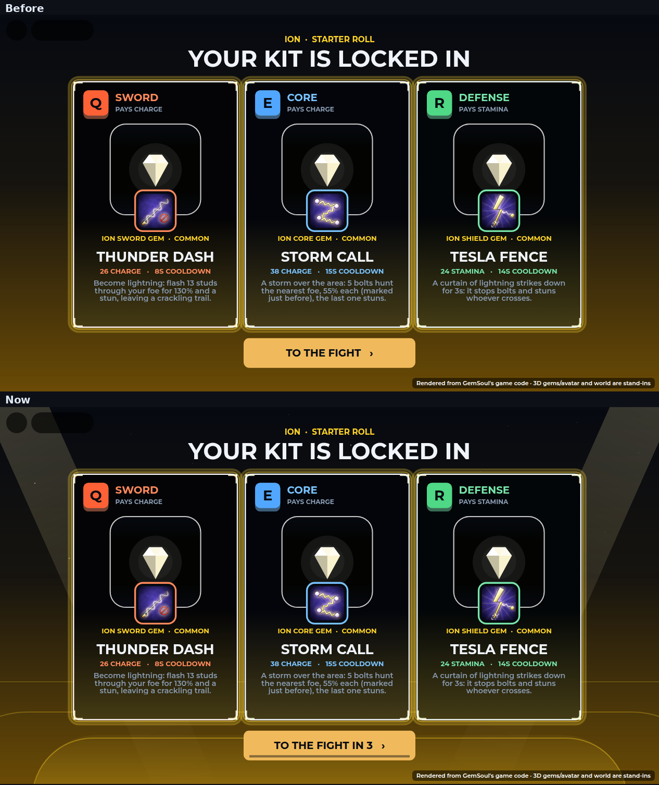
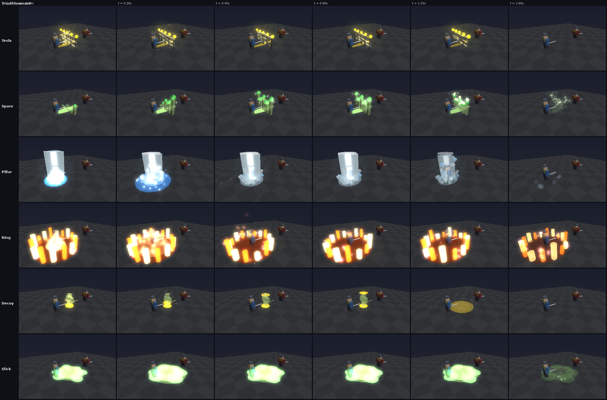
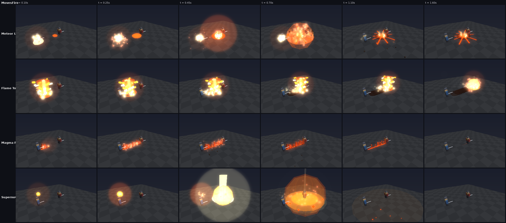
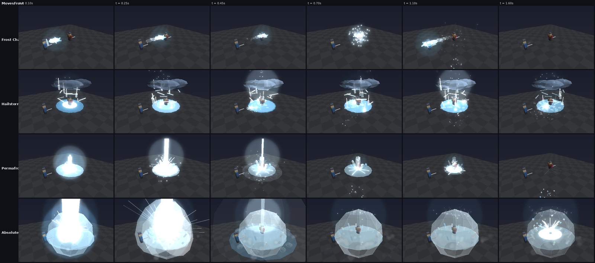
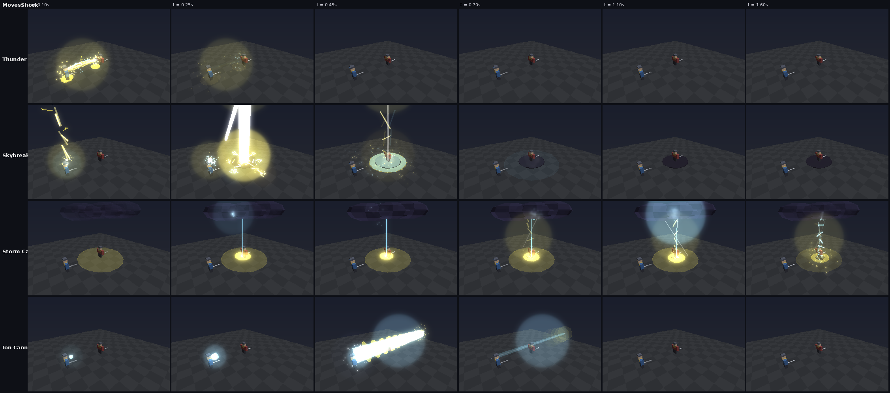
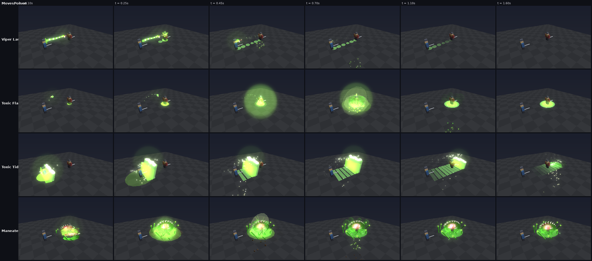
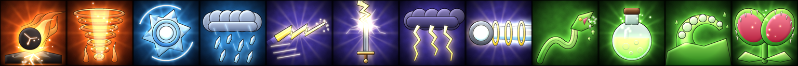

# The showcase starter kit (2026-10-13)

A new player picks a style and an element. Each of Q, E and R is then rolled
from two showcase moves of that element (`GemTraits.Intro`). These are the
flashy moves; for now, the intro picks them for looks and fun, not for depth.
R is never a shield. It is a wall, or a move that changes the ground around
you. Shields still exist as R moves on gems mined later.

The picker shows each element and its strengths: what its hits do, what it
beats and what beats it. It never shows the moves. Those stay a surprise
until the roll.

| Style | Element | The roll: each card's circle is a reel that lands on your gem, which gives up its surge |
| --- | --- | --- |
|  |  |  |

The roll's reels are real 3D gems of your element, each on a glow of its
rarity's colour, rolling past at the real gem odds (`GemRoller`: Common 40,
Uncommon 25, Rare 20, Ultra Rare 10, Legendary 5). The window's edge and the
name under it take the colour of the gem going past. Where it stops, your
gem, is the server's roll. Only the gems in a window are 3D: each reel keeps
a few models per rarity and passes them along (a gem is about a hundred
parts). The window is a clipped frame, not a CanvasGroup, because 3D views
don't draw inside one; that is also why its corners are rounded rather than
a circle.

Once the last gem gives up its surge, the kit is locked in and the fight
starts by itself after 3 seconds: the button counts down ("TO THE FIGHT IN
3") with a bar filling under it, and tapping it goes at once. Behind the
cards is the arena you're heading to, in your element's colour: the stands
in rings round a lit floor, two spotlights and a few stars. The strip under
Roblox's top bar is dark too, all through the launch screens (it used to
show the sky, and a planet in it).

## The pools

| Element | Q (sword) | E (core) | R (defense) |
| --- | --- | --- | --- |
| Thermal | ***Meteor Leap*** / Magma Fault | Supernova / ***Flame Tornado*** | Fire Wall / **Ring of Fire** |
| Cryo | ***Frost Chakram*** / Permafrost Spire | Absolute Zero / ***Hailstorm*** | Frozen Wall / **Ice Pillar** |
| Ion | ***Thunder Dash*** / ***Skybreaker*** | ***Storm Call*** / ***Ion Cannon*** | **Tesla Fence** / **Hologram Decoy** |
| Corrosive | ***Viper Lash*** / ***Toxic Flask*** | ***Toxic Tide*** / ***Maneater*** | **Spore Wall** / **Acid Slick** |

(*Bold italic*: the starter Q and E moves added on 2026-10-14, below.)

Each element has two R moves: one **barrier** and one **escape**
(`GemTraits.Showcase`).

## The six new R moves (in bold above)

| Move | What it does |
| --- | --- |
| Ring of Fire | A ring of flame circles you for 4s. Foes who cross it burn and get thrown back. |
| Ice Pillar | An ice column lifts you out of sword reach for 2.5s, then shatters and slows everyone nearby. |
| Tesla Fence | A curtain of lightning bolts striking down, with arcs jumping between them. It stops bolts, and foes who walk through are stunned. |
| Hologram Decoy | You blink back and leave a flickering copy of yourself. It explodes in lightning when a foe gets close. |
| Spore Wall | A hedge of toadstools. It stops bolts and poisons foes who walk through. |
| Acid Slick | A bubbling acid pool. Foes standing in it are slowed and their armor is shredded. |

They are part of the full catalog: the matrix now has 66 moves, up from 60.
Gems mined later can roll them too.

## What it replaced

- **Before:** every starter kit got fixed moves: Offense #2, Ability #1 and
  Defense #1 of its element's matrix. For three of the four elements, R was a
  shield.
- **Now:** `StarterLottery.prepareChoice` rolls each key from its pool on
  the server and saves the result as `reward.Moves` (kit `Version = 4`).
  Retrying never re-rolls the kit.
- **To go back to fixed moves:** in `src/shared/GemTraits.luau`, give each
  `GemTraits.Intro[element]` lane a one-item list.

## The starter Q and E moves (2026-10-14)

Ion and Corrosive felt flat. Their moves were built around crowds (Chain
Lightning and Circuit Cleave do nothing extra against one foe) or around
numbers you can't see ("takes 20% more damage"). Cryo Stream, a held beam,
was dull. Twelve new moves replace them, and the four kept (Magma Fault,
Supernova, Permafrost Spire, Absolute Zero) got their own looks too.

**The rule:** every starter move pays off against a single opponent, and you
can see what it did. Each has its own look (`src/client/Modules/MoveVfx.luau`),
a flash and shockwave, a camera shake when it's close, its sound, and for
some a wind-up you can see (a bolt onto your raised blade, a cannon charging).

| Move | Key | What it does |
| --- | --- | --- |
| Meteor Leap | Thermal Q | Leap up to 14 studs and crash down: 150% around you, foes thrown back, a burning crater for 3s. |
| Flame Tornado | Thermal E | A fire tornado tears across 22 studs, dragging foes along and scorching them, then bursts at 90%. |
| Frost Chakram | Cryo Q | A spinning ice blade flies out 16 studs and back: 85% each way, and every hit Chills (3 freeze). |
| Hailstorm | Cryo E | Hail on an area for 3s: 24% every half second; stay 2s and you're frozen solid. |
| Thunder Dash | Ion Q | Become lightning and flash 13 studs through your foe: 130% and a stun, leaving a crackling trail. |
| Skybreaker | Ion Q | A bolt from the sky onto your foe: 170% and stunned 0.7s. |
| Storm Call | Ion E | 5 bolts hunt the foe nearest the storm, each marked just before it lands (dodgeable); the last stuns. |
| Ion Cannon | Ion E | Charge, then a body-wide beam through a 45-stud line: 230% and blown back. |
| Viper Lash | Corrosive Q | A venom whip snaps out 16 studs and drags the foe to you: 90%, poisoned and slowed. |
| Toxic Flask | Corrosive Q | Lob a flask: it bursts for 120% and poison, leaving an acid pool that slows. |
| Toxic Tide | Corrosive E | A wave of acid rolls 24 studs: 140%, poisoned, carried along, taking 15% more damage for 4s. |
| Maneater | Corrosive E | A giant flytrap bursts up under the foe and snaps shut: 160%, held 1.3s, deeply poisoned. |

Rendered from the game's own effect code (`tools/vfx_sim.luau` and
`tools/vfx_render.py`, scenarios `MovesFire`, `MovesFrost`, `MovesShock`
and `MovesPoison`):

**Where they live**

- **Moves:** `src/shared/GemTraits.luau` (the matrix grows to 78 moves). The
  new moves can also roll on mined gems.
- **Mechanics:** `src/server/Systems/TriadServer.luau` adds leaps (Pounce),
  moving storms (Vortex, Disc, Wave), area weather (Hail, Storm), thrown
  payloads (Lob), and pushes and pulls.
- **Existing saves:** starter stones that still carry an old intro move get its
  replacement in the same lane when the profile loads
  (`GemTraits.upgradeStarterProfile`). Mined stones keep what they rolled.
  Gems with no saved roll keep picking from the old lanes (`SeedLength`), so
  nobody's moves change under them.

**Icons:** twelve new icons are painted in `tools/make_ability_icons.py`, so
`assets/images/ability_icons.png` now holds 59 icons on one 1024 x 1024 sheet.

To show them in game, upload `assets/images/ability_icons.png` (Creator Hub,
Images). Then, in `src/client/Modules/SurgeIcons.luau`, set `ImageId` to the
new id, `Layout = "Sheet"` and `Uploaded = 59`. Until then each new move
shows the closest older icon (`SurgeIcons.Fallback`).
