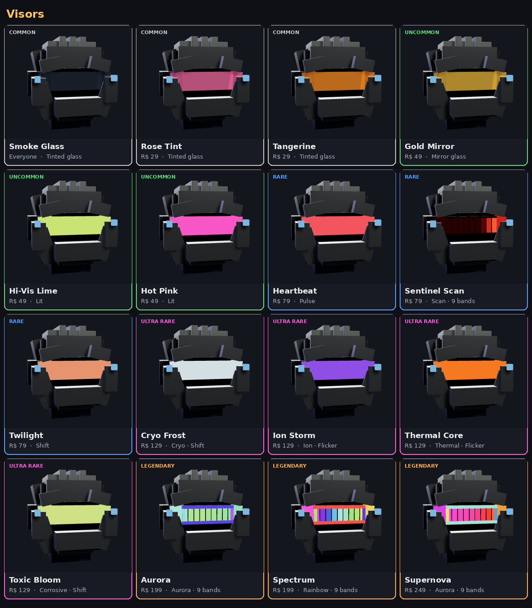

# Skins and selling (2026-10-13)

Cosmetics are looks only, never stats. Some are sold for Robux, directly
(never at random). Others are free, earned one way only, so wearing one shows
how you got it.

The store itself, with its bundles (player bundles since 2026-10-28) and prices, is in
`docs/store.md` (2026-10-15). It replaced the crates and the coin-priced trims
and back pieces described in older notes.

## What there is

| Kind | What it does | Where it's drawn |
| --- | --- | --- |
| Weapon skin | Restyles whatever weapon you hold: colours, material, sparks, a trail through every swing | `Equipment.luau`, `SKINS.Palette` |
| Suit | Restyles every armor piece, whatever its style: plates, under-layer, glow, particles off the chest | `Equipment.luau`, the suit pass in `dress` |
| Visor | Restyles the lens of whatever helmet you wear: tinted, lit, moving, elemental or many-coloured. Shows under any suit. | `Equipment.applyVisor` |
| Helmet skin | A whole new head in place of your helmet: 12 designs, the gem seated on it, eyes lit in your visor's colour | `HelmetLooks.luau`, see `docs/helmet-skins.md` |
| Title | A tag over your head, in its colour, that everyone sees | `Equipment.showTitle` |
| Back piece / trim | As before. New: the Crusader's Standard back piece | `BACKS.Standard` |

Each skin and suit is a palette in `src/shared/Cosmetics.luau`, so a new one
is only a few lines of data.

### For Robux

| Item | Kind | Robux |
| --- | --- | --- |
| Plasma Edge | weapon skin | 99 |
| Molten Core | weapon skin | 99 |
| Toxic Ooze | weapon skin | 99 |
| Void Crystal | weapon skin | 149 |
| Galaxy | weapon skin | 199 |
| Chrome Knight | suit | 299 |
| Arctic Ops | suit | 299 |
| Obsidian Lava | suit | 399 |
| Neon Runner | suit | 399 |
| Royal Gold | suit | 799 |
| Starter Pack | Ignition suit (only here), Molten Core, Bone Crusher, Ember Trim, 1,000 coins | 99, one time, for 48 h after your first win |
| Season premium | a second reward track: Moonsteel skin, LUNAR VANGUARD title, Lunar Frontier suit, coins | 399 |

Every skin, suit and pickaxe for sale, and the bundles, are listed in
`docs/store.md`. The visors are below ("Visors"). The helmet skins are in
`docs/helmet-skins.md`.

### Free (exclusive, never sold)

| Do this | Get this | Where it's handled |
| --- | --- | --- |
| Bring 1 friend | **Kindred Edge** (Legendary weapon skin, only from here) | `Systems/Referrals` |
| Bring 2 friends | Twin Star (pickaxe) | `Systems/Referrals` |
| Bring 3 friends | Starlink Visor (animated sapphire/violet/gold lens) | `Systems/Referrals` |
| Bring 4 friends | Crusader Gold (weapon skin) | `Systems/Referrals` |
| Bring 5 friends | Crusader Plate (suit) | `Systems/Referrals` |
| Bring 10 friends | Celestial Aegis (shield skin, separate from sword skins) | `Systems/Referrals` |
| Join the Roblox group | Starforged (weapon skin) | `Systems/FreeRewards` |
| Log in 7 days in a row | Daybreak (weapon skin) | `PlayerData` (the daily streak) |
| Redeem a promo code | whatever the code gives (LAUNCH: the FOUNDER title) | `Systems/Codes` |

Free rewards are put on as soon as they're earned, so other players see them.
The Shop's **Free** tab shows every one, with your progress.

### Bring a friend

**Kindred Edge** is the first reward (`SKINS.Kindred` in `Equipment.luau`), a blade "forged for two":

- A dark, starlit crystal blade.
- Two strands of neon, teal and gold (the gold matches the hilt), wind round each other from the guard to the point. They're built from short linked neon parts, so they show in shop previews and in first person too.
- The edge pulses with white starlight.
- Teal and gold motes drift up off the blade, and its swing trail runs from teal to gold.

How a friend counts (`Systems/Referrals`):

1. You invite them with Roblox's game invite, from the lobby's **INVITE** tile or the Shop's Free tab. Both run `ReferralUI.invite`. In a Studio playtest it says invites only work in the live game.
2. When they join, Roblox tells the server who invited them (`ReferredByPlayerId`), and that friend is counted once, in a DataStore. A failed save is tried 3 times.
3. If you're in the same server, the reward goes on at once.
4. If you're in another server, a MessagingService message (`GemsoulReferralJoined`) carries your new count there, and it goes on at once.
5. If you're offline, it goes on at your next join, or when you press **CHECK CLAIM**.

The Bring a Friend window shows the skin turning in 3D. Once it's yours, the progress row moves on to the next reward, and the second button puts the skin on or takes it off.

## The designs (the full collection)

There are 27 weapon skins and 21 suits, all of them in `src/shared/Cosmetics.luau`. Renders of every
one:

- `docs/skin-designs/skins_gallery.png`
- `docs/skin-designs/suits_gallery.png`

A palette can ask for more than one colour:

| Palette field | What it draws |
| --- | --- |
| `Accent` + `Pattern` | A second plate colour. **Camo** is patches, the same on both sides. **Stripes** is bands across the body. **Trim** is the smaller plates: edges, straps, veins. |
| `Seams` | Neon trim set into plates: a frame round each plate's outward face (a single line down a plate too narrow to frame), on the 9 broadest plates of each armor piece and the 2 biggest of a weapon (both sides). |
| `Blade` + `BladeMaterial` (skins) | The blade's own colour and material: lava for Molten Core, glass for Glacier Shard, neon for Solar Flare. |
| `Edge` (skins) | A neon strip down each cutting edge of the blade, a little thicker than the seams. |
| `SeamColor` | The trim's colour. Without it, the trim takes the glow colour. Bonk Bat and Banana Blade also use it for their neon bands. |
| `SeamWidth` | The trim's weight, from 0.018 (Frontier) to 0.036 (Solar Flare): strips are 1.6 times it, 0.035 to 0.06 studs wide. Rarer looks get bolder lines. |
| `SeamFx` | Makes the trim move (see below). Without it, it stays steady. |

### How a suit paints armour

A suit recolours the armour you wear (`repaint` in `Equipment.luau`, with `suit` set), but keeps it looking like armour:

- **The visor stays as it is.** The builders mark visor parts (the glass, the dark well behind it, a bucket helm's slits) with a `Visor` attribute (`ArmorKits.visorPart`). The repaint skips them, so every suit keeps the standard visor (or your visor cosmetic).
- **Light and shade are kept.** Each part takes the palette's colour at its own relative brightness, so a lighter edge stays lighter and a deep trim deeper, and the armour's detail still reads.
- **Nothing blacks out.**
  - A part keeps at least 85% of its own brightness under the plates, and 55% on them.
  - There's also a floor for each.
  - Dark suits (Stealth Black, Neon Runner, Obsidian Lava) read as gunmetal and indigo with their plates showing, not as a black silhouette.
- **Clean finishes only.**
  - Suits use SmoothPlastic, Metal, Foil, Glass or Neon. Gritty textures (fabric weave, rust, concrete, slate, basalt, marble) are gone.
  - Weapon skins drop the gritty ones too. They keep the materials that make them: Molten Core's lava blade, Glacier Shard's ice, Bonk Bat's wood.
  - `tests/skins_store_cases.luau` checks this for every look.

### The neon look

Every suit and every weapon skin has glowing trim, like Neon Runner and Raid
Breaker always had. The trim is real parts: thin neon strips set into the
plates, welded where the plate is (`inlay` and `edgeLines` in `Equipment.luau`):

- It hides behind the armour in front of it, as the armour does. (It used to be
  SelectionBoxes, which Roblox draws as all twelve edges of a box, through
  whatever is in front: a suit read as a tangle of wireframe.)
- It shows the same in the world, in first person, in the Inventory and in the
  Store. (A ViewportFrame doesn't draw a SelectionBox at all.)
- A frame goes round each plate's outward face: the broad side facing away from
  the body part it's worn on, or for a block, the face that direction leaves by.
  A plate too narrow to frame gets one line down its middle.

Which looks have it:

- Every suit has `Seams`.
- Every palette skin has an `Edge`.
- All but the three cheapest (Frontier Steel, Rust Bucket, Camo Ops) also trim the guard and grip with `Seams`.
- Bonk Bat and Banana Blade have neon bands instead.

The tests check this for every look.

Each look has its own colour pairing: plate, under, and contrasting trim. Pale looks get strong trim so the lines still show:

- gold on Champion Plate;
- violet on Lunar Frontier;
- gold to red on Crusader Plate.

Steady trim is the default. `SeamFx` animates it on every client (`SeamVisibility`). 21 looks use it:

| SeamFx | What it does | Looks |
| --- | --- | --- |
| `Pulse` | Breathes, bright to dim and back (1.8 s). | Circuit Rig, Obsidian Lava, Neon Runner, Lunar Frontier, Champion Plate; Molten Core, Circuit Board, Champion's Edge, Ore Vein Gold |
| `Shift` | Swings between the trim colour and the glow (2.6 s). | Royal Gold (gold to amethyst), Nebula Suit, Crusader Plate (gold to red); Daybreak, Void Crystal, Nebula, Crusader Gold |
| `Flicker` | Crackles like a live wire, with sharp flashes of the glow. | Storm Conductor, Raid Breaker; Warlord's Edge, Solar Flare |
| `Rainbow` | Runs through every hue. | Chrome Knight; Galaxy |

How the effect gets to the client:

- The server only tags each strip (`SkinSeam`): `SeamFx`, `SeamA` (its own colour), `SeamB` (the glow) and `SeamSeed` (shared by a plate's strips, so its frame moves as one).
- `SeamVisibility` reads those attributes once per strip and again only when a restyle changes them.
- It recolours just the animated strips that are showing and within 120 studs, 20 times a second (a suit has over a hundred strips).
- A strip restyled to a steady look goes back to its own colour.
- Copies move too: your first-person weapon, the Inventory's miner and item art, the Shop and Wardrobe previews and the lottery's reward art. See "Copies move as the gear does" in `docs/gear-looks.md`.

Three skins have their own look in `Equipment.luau`:

- **Solar Flare** (`SKINS.Solar`): the palette plus flames along the whole blade.
- **Bonk Bat** and **Banana Blade** (`SKINS.Bonk`, `SKINS.Banana`): they swap the weapon's model for
  their own, built along the old blade and held the same way.

Where the new ones come from:

| Source | Items | Works now? |
| --- | --- | --- |
| Everyone | Frontier Steel, Frontier Fatigues | Yes: given to every profile on load. |
| Store (once crates) | Rust Bucket 49, Rust Rig 99, Camo Ops skin 49 and suit 149, Copper Wire 79, Copper Coil 149, Circuit Board 99, Circuit Rig 249, Nebula 199, Nebula Suit 399 | Once their Developer Products exist. Crates are gone; these are sold directly and in bundles. |
| Robux | Glacier Shard 99, Bonk Bat 149, Banana Blade 149, Stealth Black 199, Storm Conductor 299, Biohazard 299, Solar Flare 399 | Once their Developer Products exist (the slots are in `Store.RobuxProducts`). |
| Season 1 free track | Crater Grey (level 15), Moon Dust (level 25) | Yes |
| Achievement, Ranked, Raid, Mining | Veteran Steel, Champion's Edge, Champion Plate, Warlord's Edge, Raid Breaker, Geode Crust, Fossil Bone, Fossil Shell, Ore Vein Gold | Not yet. They're in the Shop with how to earn them (`How`), but the systems that grant them are still to build. |

## Visors

A visor restyles the lens of whatever helmet you wear. Like a suit, skin or
pickaxe, each miner wears its own (`Cosmetics.MinerKinds`). The Wardrobe has
a VISORS tab, and the Store has a Visors tab. Without one, every helmet wears
the same standard visor, one cyan (`SuitTraits.DefaultVisor`), whatever its
roll: the Wardrobe's "Standard". Gear rolls still save a visor (and a Matrix
visor's planned perk), but it no longer colours the lens, so a visor
cosmetic is the only way to give it another look.

| Visor | Rarity | Robux | Look |
| --- | --- | --- | --- |
| Smoke Glass | Common | free, everyone | dark smoked glass |
| Rose Tint | Common | 29 | pink glass |
| Tangerine | Common | 29 | orange glass |
| Gold Mirror | Uncommon | 49 | astronaut's mirrored gold |
| Hi-Vis Lime | Uncommon | 49 | lit lime |
| Hot Pink | Uncommon | 49 | lit pink |
| Heartbeat | Rare | 79 | red, beating (Pulse) |
| Sentinel Scan | Rare | 79 | a red eye sweeping a dark lens (Scan, 9 bands) |
| Twilight | Rare | 79 | violet to orange and back (Shift) |
| Thermal Core | Ultra Rare | 129 | forge orange, flickering, shedding embers |
| Cryo Frost | Ultra Rare | 129 | ice blue breathing to white, snow and mist drifting off |
| Ion Storm | Ultra Rare | 129 | violet static with white sparks crackling over it |
| Toxic Bloom | Ultra Rare | 129 | radioactive green, bubbling, a haze off it |
| Aurora | Legendary | 199 | teal, green and violet flowing across 9 bands, framed in light |
| Spectrum | Legendary | 199 | a rainbow across 9 bands, its frame the opposite hues |
| Supernova | Legendary | 249 | gold, magenta and electric blue flowing across 9 bands, stardust drifting off |

What each rarity promises (the tests hold every visor to it):

- **Common:** tinted glass.
- **Uncommon:** a lit lens, or mirror glass.
- **Rare:** the lens moves.
- **Ultra Rare:** it moves, and an element comes off it.
- **Legendary:** a framed lens of 9 bands, with colour flowing across it.

How it's built (`Equipment.applyVisor`, after everything else in `dress`):

- **Lens parts:** every helmet builder marks its lens parts `VisorFace` (`ArmorKits`). The dark well round the lens and its lamps keep their own look. The visor restyles those parts on every helmet: the main lens, the wrap-around side lenses, a monocle or a headlamp lens.
- **Banded looks:**
  - The main lens is cut into bands standing just proud of it, with the lens itself gone dark behind them.
  - Each band, and each other lens piece, is seeded by where it sits across the face, so a scan bar or a gradient runs left to right.
  - A Legendary's lit frame (`inlay`) runs half a cycle out of step, so it stands out from the bands.
- **Moving looks:** they carry the seams' attributes and tag (`SeamFx`, `SeamA`, `SeamB`, `SeamC`, `SeamSeed`, `SkinSeam`). Every client animates them (`SeamVisibility`), first person and the Store and Inventory previews included (`LiveLooks`).
- **New effects:**
  - `Scan`: a bar sweeps to and fro in 2.8 s.
  - `Aurora`: three colours flow round the colour wheel in 4.5 s, never through grey.
- **Elements:** the same effects a gem's stone gives off (`STONE_FX`), from the lens.
- **Lights:**
  - A lit lens has a soft light in its colour.
  - The light beats with a Pulse and flickers with a Flicker, on each client (`GemLights`).
- **Previews:** the Store's preview is the visor on a Juggernaut helmet (`Equipment.cosmeticPreview`). Previews show the lens moving, but not its particles or light, which a ViewportFrame can't draw.

## To switch selling on

Nothing sells for Robux until you create its product.

1. On the game's page on Roblox: **Monetization > Developer Products**. Create
   one product per row of the Robux table above, at its price.
2. Paste each product's id into `Store.RobuxProducts` in
   `src/shared/Store.luau`. The key is the cosmetic's id (`SkinPlasma`,
   `SuitRoyal`, …), or `StarterPack` or `SeasonPremium`.
3. Until an id is set, pressing Buy says it's coming soon (or, while
   `Config.TestCosmeticPrice` is set, buys it for coins). Bundles need
   products too: see `docs/store.md`.

Purchases are safe to retry:

- Each Roblox purchase is granted once, by its `PurchaseId`. The last 200 are
  kept on the profile.
- The profile is saved right after a purchase, and a purchase only counts
  as done once that save has gone through. Asked about again while saving
  still fails, it waits again; it's never granted twice.
- A session that doesn't save (the save didn't load, or another server took
  it over) grants nothing: the purchase waits for the next session that
  saves, so nothing paid for is lost when the player leaves
  (`PlayerData.keeps`, since 2026-10-28).
- A bought skin or suit goes straight on.

## To switch the group reward on

Put your group's id in `Config.GroupId` (`src/shared/Config.luau`).

- **While it's 0:** the Free tab says "Coming soon".
- **Once it's set:** members get the skin on joining the game, and anyone who
  joins later presses CHECK.

## Promo codes

Codes live in `src/server/Systems/Codes.luau`. That file is server-only, so
players can't read the list out of the game.

- **To add one:** add a line with the code in capitals, its reward, and
  optionally an expiry date.
- **Redeeming:** each player can redeem each code once. Players can type it
  any way ("launch" or "Launch!" both work), and the server allows one try
  every 2 seconds, so codes can't be guessed by brute force.
- **The starter codes are examples.** Change them before posting:
  - LAUNCH: the FOUNDER title + 500 coins
  - CRUSADERS: 500 coins
  - GEMRUSH: 750 coins + 30 min of 2x XP

## Roblox rules to keep to

- **Discord:** don't reward joining a Discord server, or any other off-Roblox
  action. Roblox doesn't allow it, and the game can't check it anyway. Post
  codes in Discord instead, since anyone can redeem them. Discord links belong
  on the game page's Social Links, which Roblox shows only to users old
  enough to see them. In game, the Store names Discord (the promo codes
  card, a code-only look's "how to get it") only to players PolicyService
  allows it for (`AllowedExternalLinkReferences`); everyone else reads
  "codes come with game updates and at like milestones" (since 2026-10-28).
- **No random items for sale.** The store sells only named looks and bundles;
  crates are gone. Keep it that way: paid random items need odds shown and
  are restricted in some countries.
- **Joining the group and inviting friends** are both Roblox features. The
  game checks them with `IsInGroup` and the invite's join data. Both are fine
  to reward.

## Tests

`tests/skins_store_cases.luau` (`tests/run_skins_store.py`) covers:

- **The catalog:** every skin and suit can be drawn, every Robux item has a
  product slot, and exclusives are never sold.
- **Receipts:** every product type, each purchase granted only once, and
  unknown products refused.
- **Season premium:** claiming it once, and every premium reward.
- **The Starter Pack's 48-hour window.**
- **Promo codes:** each code once, codes typed loosely, made-up and expired
  codes, the 2-second limit between tries.
- **The group reward:** stays off with no id set.

- **Visors:** every visor's look is valid and keeps its rarity's promise, there's one of every element, and every visor for sale is in The Vault. `Scan` crosses the whole lens and `Aurora` reaches its three colours without going grey.

`tests/gear_look_cases.luau` puts every visor on all 15 helmets and checks:

- the lens takes the look;
- moving lenses are tagged to move;
- bands sit in front of the lens, seeded left to right;
- the Legendaries are framed;
- elements and lights are there;
- nothing but the visor changes, under a suit too, and in the one-helmet preview.

`tests/armor_articulation_cases.luau` checks every lens part is marked `VisorFace`.

`tests/referrals_cases.luau` covers the invite tiers.
