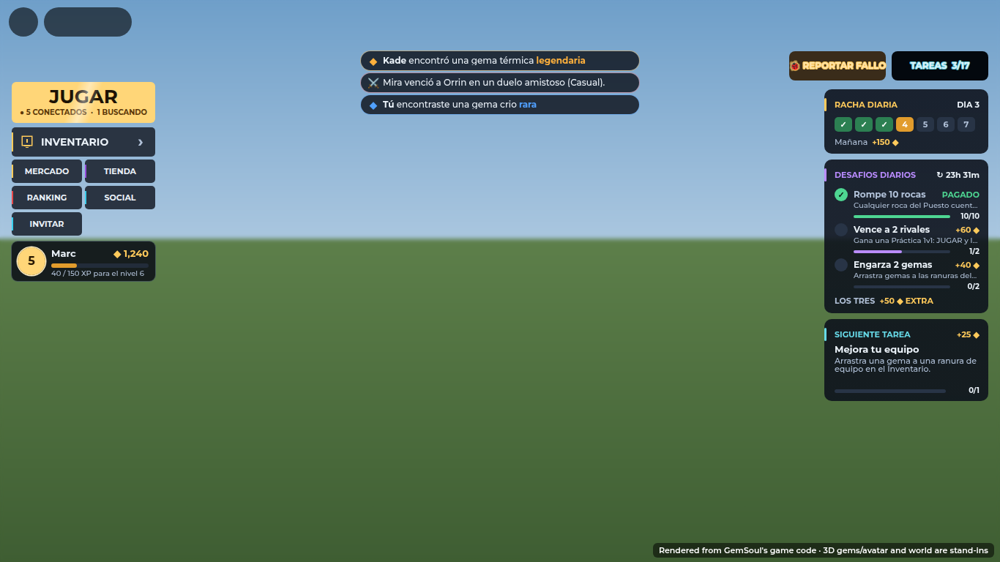
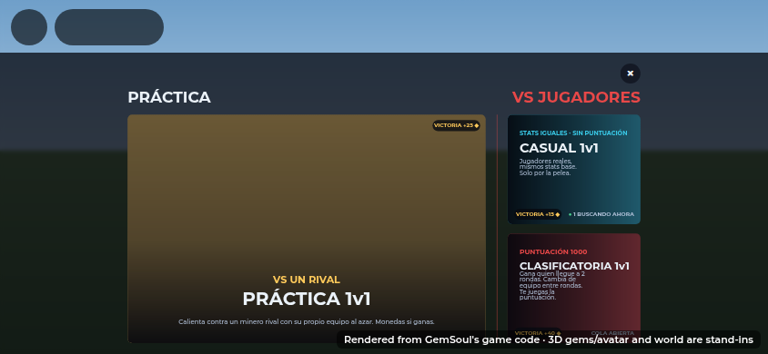
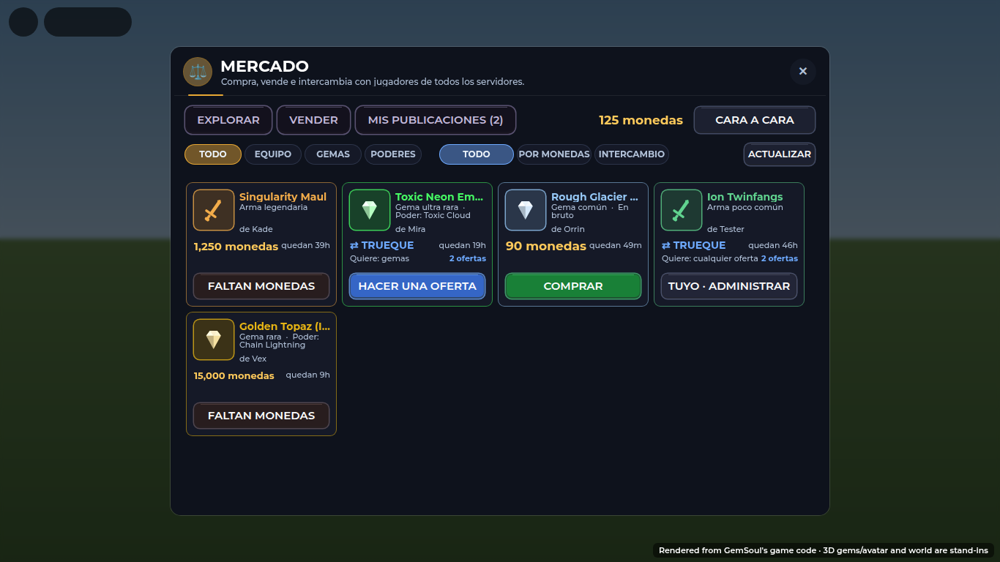
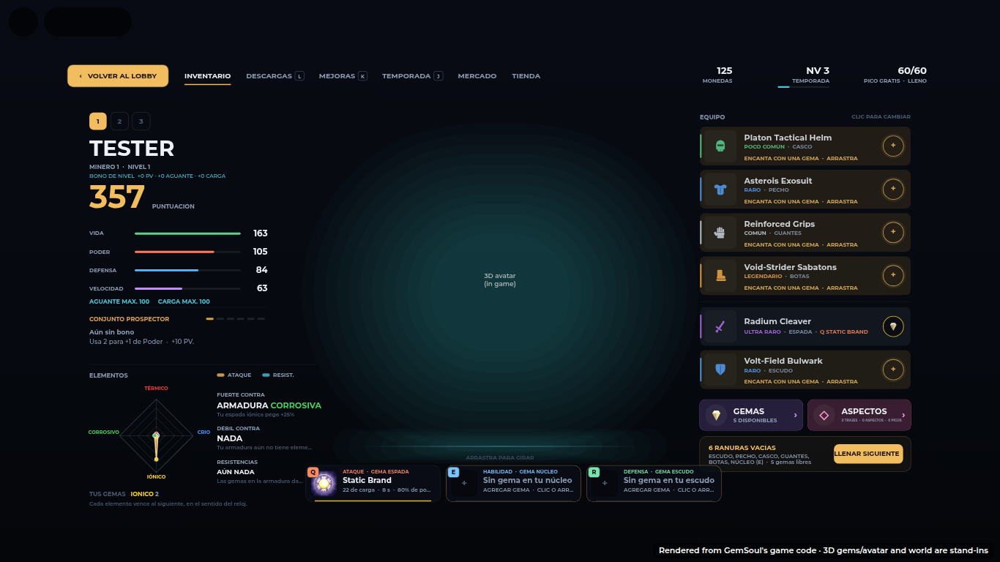
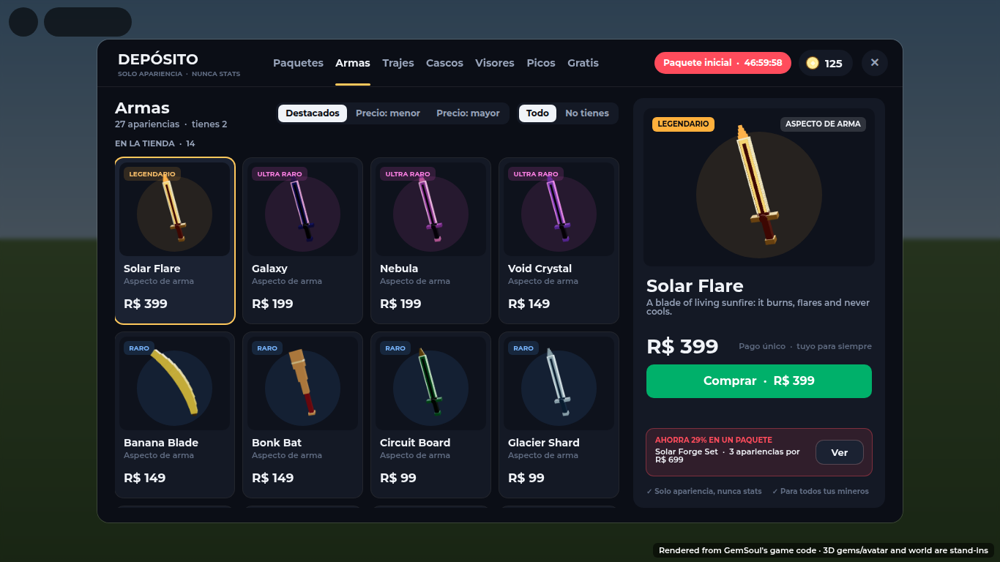

# Spanish

A player whose Roblox language is Spanish (any `es-…` locale) sees the game
in Spanish: neutral Latin American, with *tú*. Everyone else sees English,
and for them nothing runs.

## How it works

Screens still write English. One client script translates text as it is set:

| File | What it does |
| --- | --- |
| `src/client/Translate.client.luau` | Watches PlayerGui: every TextLabel and TextButton `Text`, and every TextBox `PlaceholderText`, as it is set. Also translates action prompts (`ProximityPrompt` ActionText / ObjectText) as they show |
| `src/shared/Lang.luau` | The lookup rules |
| `src/shared/LangEs.luau` | The Spanish table: `["English"] = "Español"` |

The language comes from:
1. the player's `Language` attribute, which the DEV panel's LANGUAGE row
   sets (ENGLISH / ESPAÑOL) for testing;
2. otherwise `LocalizationService.RobloxLocaleId`;
3. otherwise `Player.LocaleId`.

Switching back to English puts every label back to the English the game
last wrote.

## Writing entries

A text is looked up in this order:

1. **Exact.** `["PLAY"] = "JUGAR"`.
2. **With numbers.** Every number in the text becomes `{1}`, `{2}`… (in
   order), so `"Break 10 rocks"` uses the entry `["Break {1} rocks"] = "Rompe {1} rocas"`.
   The Spanish may use them in any order.
   - A number counts as `"40"`, `"1,250"` or `"3.5"`, and the digits of
     `"39h"`. It doesn't count inside `<tags>`, glued to a word before it
     (`"R2"`), or in `"1v1"`.
3. **Wildcards.** `{*}` matches any text and translates it too; `{=}` matches
   text kept as it is (a player's name, an item name, a number). In the
   Spanish, `{*}` and `{=}` take the matches in order, or `{*2}` / `{=1}`
   names one. The entry with the most fixed text is tried first, so
   `"<b>You</b> found…"` wins over `"<b>{=}</b> found…"`.
   - `["DAILY CHALLENGE: {*}  +{=} coins"] = "DESAFÍO DIARIO: {*}  +{=} monedas"`
   - `["{=} defeated {=}"] = "{=2} cayó ante {=1}"`
   - Keep a wildcard entry free of `{1}` and digits: use `{=}` for a number.
   - Anchor it on real words. `"{=} s cooldown. {*}"` once matched a
     whole surge line, because `{=}` swallowed everything before it.
4. **In pieces.** Text with no entry is split. Rich-text tags are kept and
   the words between them are translated, and so is each part of a `"\n"`,
   `"  ·  "` or `" · "` list. Spaces around a piece are kept.

ALL-CAPS text uses the entry for the same words in any case: `"RARE"` uses
`["Rare"] = "Raro"` and shows `"RARO"`, accents included.

Text built in code can also be filled from an entry directly, with
`Lang.format("Break {1} rocks", 12)`.

`python3 tests/run_lang.py` runs the rules and checks every entry:
- number keys are exactly what the game would make of such a text;
- the Spanish uses no number or wildcard the key lacks;
- the rich-text tags match.

### Words

| English | Spanish |
| --- | --- |
| coins / gem / rock | monedas / gema / roca |
| mine / miner / pick / swing | minar / minero / pico / golpe |
| Surge / Charge / Stamina | Descarga / Carga / Aguante |
| Health (HP) / Power / Defense / Speed | Vida (PV) / Poder / Defensa / Velocidad |
| guard / duel / Practice / Ranked | guardia / duelo / Práctica / Clasificatoria |
| Outpost / gear / loadout | Puesto / equipo / equipamiento |
| socket (verb) / enchant | ranura (engarzar) / encantar |
| Store / Market / Tasks | Tienda / Mercado / Tareas |
| skin / suit | aspecto / traje |

Item, cosmetic, move, enemy and place names stay in English: they're names.

## What stays in English

- **Names**: players, items, gems, cosmetics, moves, enemies, places.
- **Long catalog descriptions**: cosmetic flavour text, gem trait and item
  perk descriptions (`Cosmetics`, `GemTraits`, `ExpandedItemTraits`,
  `Classes`).
- **Anything marked `NoTranslate`.** A GUI with the `NoTranslate` attribute
  keeps its text, and so does everything inside it. Set on:
  - chat (ChatFrame, the Social chat log);
  - player names in the lobby and in fights;
  - the DEV panel.
- **World billboards**: name plates and the Outpost's signs. These sit in
  the workspace, not in PlayerGui. Damage numbers are the exception:
  `Combat.client` translates them itself ("CRÍT 120 ¡DÉBIL!").

## Longer words

Spanish runs about a quarter longer than English. The main screens were
rendered in Spanish at desktop and phone size:
- lobby, PLAY menu, Inventory, fight HUD, Social, Market;
- Store tabs, Season, starter offer, Tasks.

What spilled over was fixed in one of three ways:

- **A shorter Spanish word.** Examples: "FALTAN MONEDAS" (NOT ENOUGH COINS),
  "⇄ TRUEQUE" (FOR TRADE), "Armas" (the Weapon Skins tab), "ENCANTA CON UNA
  GEMA", "GEMA ESCUDO", "Faltan" (To do).
- **Shrink to fit.** `UiKit.fit(label)` keeps a one-line label at its size
  and shrinks it only when the words don't fit. It is used on the PLAY
  cards' kickers and titles and on the Market's prices and coins.
- **Measure the words the player reads.** Code that sizes a box from its
  text runs the text through `Lang.translate` first: the Tasks header and
  chips, and the fight HUD's SURGES title. A check that compared a label's
  `Text` with the English it set now remembers what it set instead
  (MineScene's banner, Referral's button, the SURGES title). Otherwise, in
  Spanish it would rewrite the label every frame.

| | |
| --- | --- |
|  |  |
|  |  |
