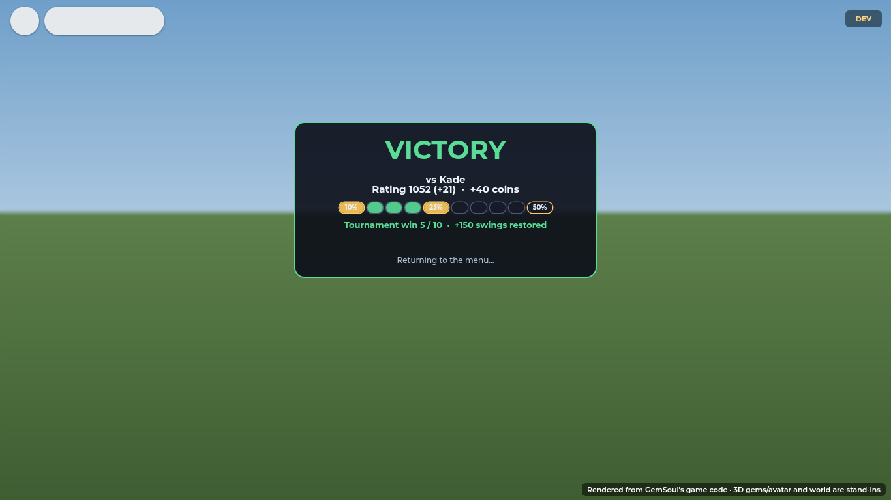
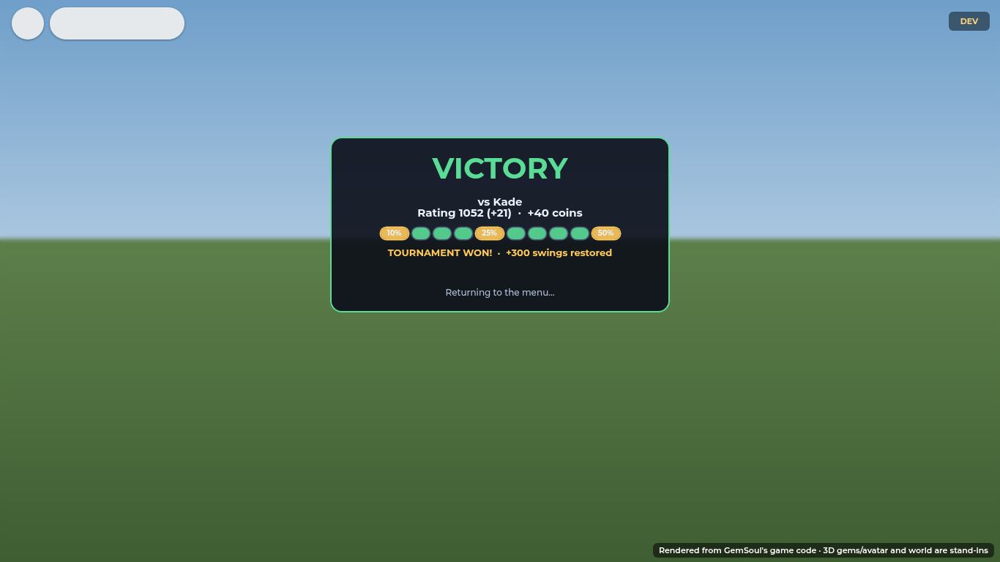
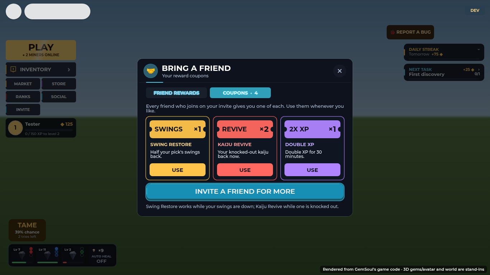
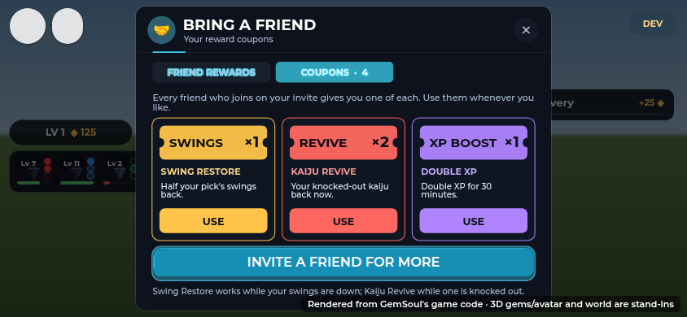

# Swing restores, the arena tournament and reward coupons (2026-10-19)

The free Survey Pick holds a long session's mining (600 swings, full again
in two hours). Once it runs low, the other modes bring swings back: that's
what pulls a miner into a 1v1 (or a dungeon, or inviting a friend) instead
of waiting. A restore is a share of the full 600, never past full, and
nothing when the pick is full already (a Robux refill can take it past full;
a restore can't). `Shared.SwingRestore` has the rules;
`OutpostServer.restoreSwings` puts them on the pick (through
`Systems/Restores`, wired in by Main).

## The arena tournament

A queued 1v1 (Ranked or Casual; a challenge between friends doesn't count)
is the arena tournament: a run of wins in a row.

| Win of the run | Restores | |
| --- | --- | --- |
| 1st | 10% (60 swings) | |
| 5th | 25% (150 swings) | |
| 10th | 50% (300 swings) | **Tournament won**: Ranked's 10th win also opens its Arena Cache, the winning roll ([arena-streaks.md](arena-streaks.md)) |

- A loss ends the run; the 11th win starts the next tournament (its 1st).
- Beating the same player twice running doesn't add to the run (no trading
  wins with a friend). Ranked runs on its streak (`RankedStreak`, the one
  the Arena Caches count); Casual has a run of its own (`Duel.CasualStreak`,
  `SwingRestore.casual`).
- The result screen shows the run: ten pips, the wins so far lit, the 10%,
  25% and 50% wins marked, and what this one did ("Tournament win 5 / 10 ·
  +150 swings restored", "your swings are full", "win 5 restores 25%
  swings", "Tournament run over"). `MatchEnd` carries it as `Tournament`.

## Dungeons

A cleared dungeon restores 25% (`SwingRestore.Dungeon`) for each of the
squad that finished it, with the clear's coins. (Dungeons are off for the
beta: `Config.Features.Dungeons`.)

## Reward coupons

Every friend who joins on your invite gives you **one of each coupon**
(`Shared.Coupons.PerFriend`), as well as the friend reward ladder's
cosmetics. They're counted once per friend (`Referrals.CouponsPaid`), also
for friends who joined before coupons existed, and wait on your profile
(`profile.Coupons`) until you use them, from the lobby's **INVITE** tile:
its **COUPONS** tab (opened first while you hold any).

| Coupon | Does | Not used (kept) while |
| --- | --- | --- |
| SWINGS (Swing Restore) | half your pick's swings back (50%) | your swings are full |
| REVIVE (Kaiju Revive) | every kaiju of yours that's knocked out, back now | none is down |
| XP BOOST (Double XP) | double XP for 30 minutes | |

Each card shows how many you have and **USE**; **INVITE A FRIEND FOR MORE**
opens Roblox's invite. The server spends them (`CouponServer`, request
`UseCoupon`), only when they'd do something.

## Kaiju revives

A knocked-out kaiju comes back by itself after a wait by its level, or now
with **REVIVE** (R$ 25, the `KaijuRevive` developer product) or a Revive
coupon. Healing waits until you're out of a fight. See
[kaiju.md](kaiju.md#knocked-out).

## Setting up for launch

- Create the `KaijuRevive` developer product (R$ 25) and put its id in
  `Store.RobuxProducts.KaijuRevive`. Until then REVIVE says COMING SOON
  (or, with `Config.TestCosmeticPrice` set, buys for coins).

## Files

| File | What |
| --- | --- |
| `Shared.SwingRestore` | The shares, the tournament (`round`, `streakShare`, `won`, `next`), `apply`, the casual run |
| `Shared.Coupons` | The kinds, per friend, count/add/take, what's owed |
| `Systems/Restores` | `give(player, share)`: the pick's swings (OutpostServer.restoreSwings) |
| `Systems/CouponServer` | `UseCoupon` |
| `Systems/Duels`, `Systems/Dungeons` | The tournament and the clear's restore |
| `Systems/Referrals` | Coupons for each friend |
| `StoreServer` | The `KaijuRevive` product (a coupon if none is down by then) |
| `ReferralUI`, `SocialUI`, `KaijuHud` | The coupons tab, the tournament on the result, REVIVE and COUPON |

Tests: `tests/rewards_cases.luau` (`run_rewards.py`), and the duel,
dungeon, Outpost, referral and store suites.
