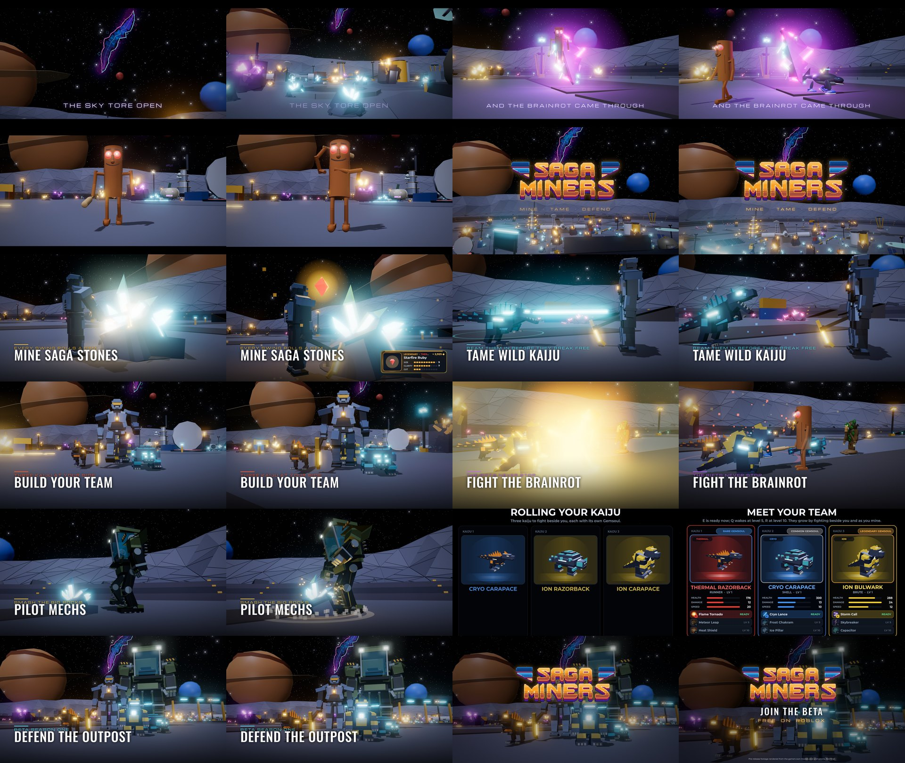

# The trailer (2026-10-19)

A 39-second trailer for the beta, cut to the game's own theme song:
[`docs/trailer/saga-miners-trailer.mp4`](trailer/saga-miners-trailer.mp4) (1920 x 1080, 30 fps, H.264 + AAC).

## What's in it

The cuts land on bar lines of the theme song (144.94 BPM); the drop is the
logo.

| Time | Shot | Music |
| --- | --- | --- |
| 0:00 | The sky rift over the Outpost: "THE SKY TORE OPEN" | the breakdown (menu theme), 4 bars |
| 0:03 | A rift tears open in the quarry; Tung Tung Sahur and Tralalero hop through | |
| 0:07 | Sahur runs at the camera and winds up its bat | the sting's lead-in bar |
| 0:08 | SAGA MINERS over the quarry | the final drop (fight theme), 16 bars |
| 0:12 | MINE SAGA STONES: three swings on the beat, a Legendary pops out, the loot card lands | |
| 0:15 | TAME WILD KAIJU: a Cryo Razorback held in the beam, then it roars | |
| 0:18 | BUILD YOUR TEAM: running in with three kaiju | |
| 0:22 | FIGHT THE BRAINROT: kaiju against critters | |
| 0:25 | PILOT MECHS: a Hauler walks in and slams a Crystal Boulder | |
| 0:28 | The starter roll (MEET YOUR TEAM) | |
| 0:31 | DEFEND THE OUTPOST: the team under the rift | |
| 0:35 | Logo, JOIN THE BETA, FREE ON ROBLOX | the drop's first hit, ringing out |

The sound effects are the game's own (`assets/sounds`): pick hits, the
Legendary reveal, the kaiju roars, element impacts, the roll's lock.

## How it was made (and what isn't real)

**It is not captured gameplay.** Nothing was recorded in Roblox. Every shot
was rendered offline from the game's code:

- **The world:** `OutpostWorld.build` with a rock on every spot, exactly as
  the server builds it.
- **The characters:** each is posed frame by frame by the game's own
  animation code:
  - kaiju: `KaijuModels` posed by `CreatureMotion`, as CreatureAnimation runs it
  - critters: `Duelist.creatureBody` with BrainrotSkins, posed by `RivalPose`, as BodyPoses runs it
  - mechs: `OutpostMachines` with `MechMotion` and MechAnimation's slam
  - the miner: the Crusader suit from ArmorKits, holding the Outpost pick, swinging it as MineScene does
- **The rifts:** the ground tears are `RiftTear.pieces`. The sky rift is
  `SkyRift`'s own picture.
- **The UI:** the loot card and the starter roll are the real screens
  (`MinerLoot`, `KaijuRoll`), rendered by the offline UI harness. The roll
  cards' 3D windows show the kaiju framed with KaijuRoll's own camera.

It is drawn by three.js, not Roblox, so these differ from the game:

- **Lighting:** materials, bloom and shadows are approximations.
- **Effects:** the hit bursts, the taming beam, the gem popping out and
  the mech's dust ring are stand-ins drawn for the trailer, not the
  game's particle effects.
- **Paths:** where things walk is choreographed by hand. The game's AI
  doesn't drive them.
- **Scale:** sizes are the game's own: pets at 0.55, the wild kaiju at
  0.9, critters at 0.55.

The end card says so: "Pre-release footage rendered from the game's own
models and animations. Not final." Keep that line if you use the trailer
as an ad. Roblox expects ads to show the game as it plays.

## Making it again

The scripts are in `tools/trailer/` (see its README). They need Lune, Node
with three.js 0.160 and Playwright, and Chromium.
