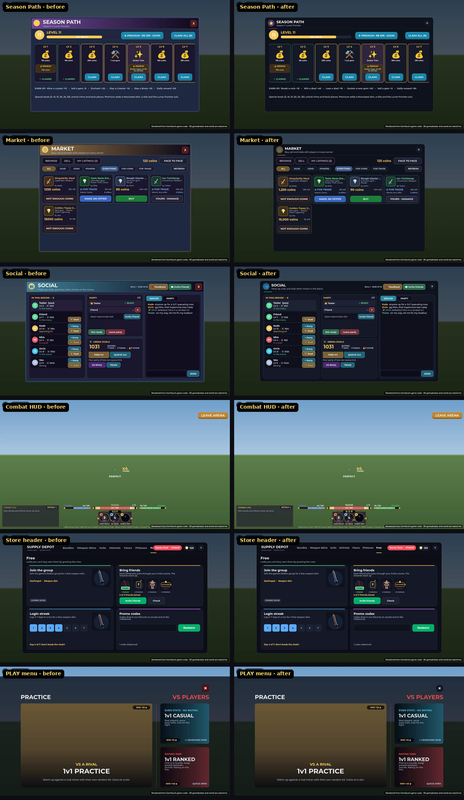
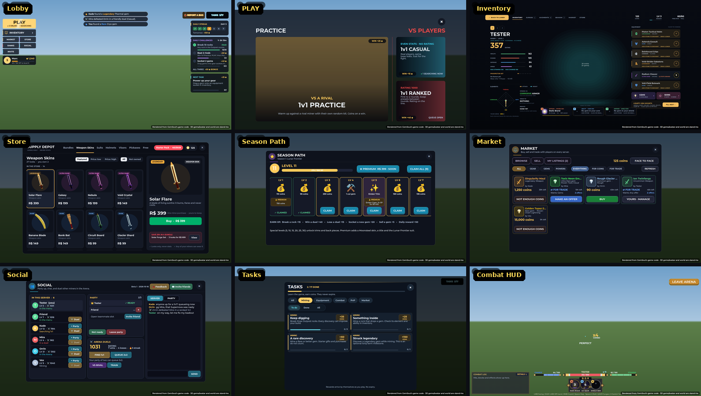
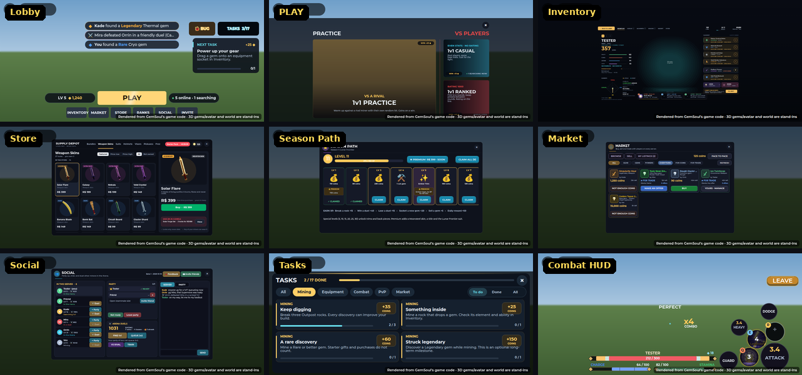

# UI style (2026-10-16)

Every window, panel and HUD in the game should look like one game. The Store
and the Inventory set the style, and the rest now follow it. This page lists
the shared pieces, so a new screen picks them up rather than inventing its
own.

## The window frame

`IronUi.window(name, order, width, height, icon, accent)` builds 13 windows:
- Season Path, Social, Market, Trade, Ranks and Invite;
- Augments, Surge Array, Character, Party and the combat guide;
- the menu mine and the Probe exchange.

It now has the Store's look:

| Part | Look |
| --- | --- |
| Body | Navy fading down (14, 18, 28 to 7, 9, 15), a 1 px white hairline at 86% transparency, 14 px corners |
| Header | Clear, over a hairline, with the window's colour as a short bar under the title |
| Icon | The window's icon in a round chip tinted with its colour |
| Title | 22 px Gotham Black, with the subtitle 12 px under it |
| Close | A quiet round X (36 px) drawn from two bars (`IronUi.cross`), lighter on hover |

The API is unchanged (`Gui`, `Panel`, `Header`, `Close`, `Title`, `Subtitle`,
`Fit`, `Dock`), and so are the content positions.

## The palette

`IronUi.Colors` was the old station violet. Its four surface tones are now the
navy-slate of the Store and the Inventory, with a hint of violet left. That
covers about 200 uses in 20 files.

| Colour | Before | Now |
| --- | --- | --- |
| `Frame` | 12, 10, 25 | 11, 13, 24 |
| `Inset` | 26, 22, 43 | 21, 25, 39 |
| `Slot` | 40, 33, 61 | 31, 36, 55 |
| `Edge` | 99, 83, 137 | 74, 86, 118 |

The accents (Gold, Teal, Amethyst, Good, Bad) are unchanged.

## Type

- Gotham everywhere: Black for titles, Bold for headings, Medium and Regular
  for body text.
- The combat HUD's names and headings were Merriweather, a serif left over
  from before the sci-fi look. They're now Gotham Bold
  (`HudChrome.Title`):
  - your name over the health bar;
  - "Q · E · R";
  - "COMBAT LOG" and "FIGHT DETAILS";
  - the rival's name;
  - the matchup card.
- In-world signs (Michroma), the splash prompt (Arcade) and the dialogue
  typewriter (Code) keep their faces on purpose.

### Glyphs that show as boxes

Gotham has no ✕ ▾ ▴ or ↻: in game each one showed as an empty box,
though the offline renders (a browser font) drew them fine. ◂ and ▸ are
the same small triangles, so they're treated as missing too.
- An X is drawn from two crossed bars: `IronUi.cross(button, length,
  colour)`. Every close button uses it, and the party's kick button.
- An arrow is a "›" turned with `Rotation` (90 points down, -90 up), as on
  the lobby board. "‹ ›" stand in for the small triangles in labels.
- These render: › ‹ ◆ ✓ · and emoji.

`tests/run_glyphs.py` fails if one of the six is in a string anywhere in
`src` (comments may name them).

## Fixes found in the renders

| Screen | Problem | Fix |
| --- | --- | --- |
| Store | The Starter Pack's clock covered the last tab ("Free") | Tabs at 14 px with 16 px gaps; about 36 px clear of the clock |
| Season Path | "Earn XP" listed dungeon kills (closed in the beta) and left out duels | Break a rock, win a duel, lose a duel, socket a new gem, sell a gem, daily reward. Dungeon kills only while dungeons are open |
| Market | The first row's card outlines were cut off by the scroll area; prices like "15000 coins" | 2 px padding inside every list; prices like "15,000 coins" |
| Combat HUD | A surge's rarity ("Legendary") spilled past its round button | It shrinks to fit (6 to 10 px), in the rarity's colour |
| Inventory | The last element line ran under the Q card | That line is as narrow as the value above it, with shorter words |
| PLAY menu, Tasks | Square close buttons (a red one on PLAY) | The same round X as every window |

## Screens

## How the renders are made

The screens are rendered from the game's own code. Lune runs the client
modules against stand-in Roblox services, writes the GUI tree as JSON, and a
headless browser draws it. 3D models and the world are placeholders.
