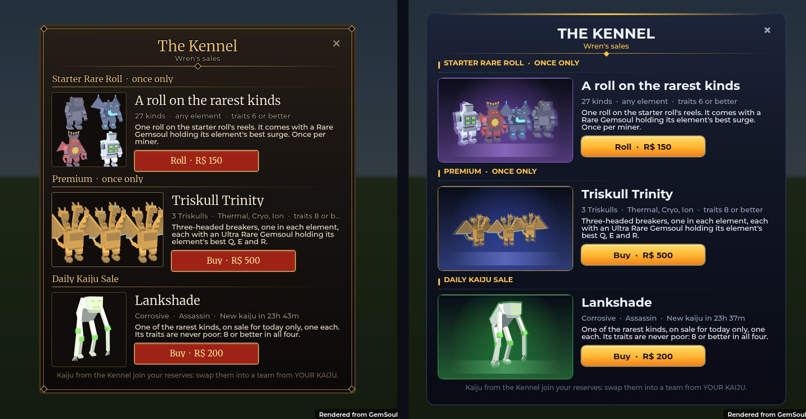
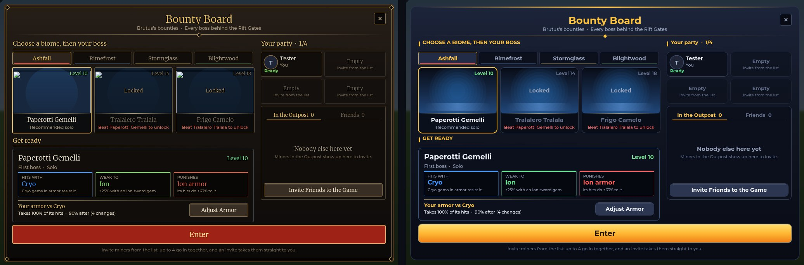
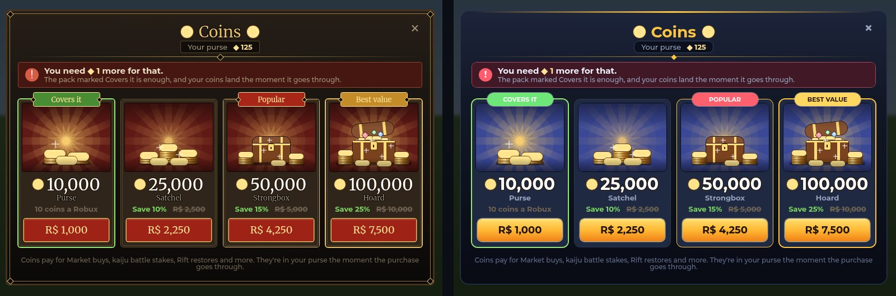

# The windows' new look (2026-10-29)

The Bounty Board, the Kennel's sales and the coin packs were in a brown and
gold "gilt" look with serif type. They're now in one modern look, set in one
place (`Client.GiltUi`, which keeps its name and calls):

- deep navy panels with a cool sheen down them and a steel edge, an amber
  bar glowing along the top;
- bold Gotham type, section headings in amber capitals with a tick and a
  hairline;
- the button that matters in glossy amber with dark words, the rest slate;
- colour kept for what it means (an element, a level's danger, ready or not).

Left: before. Right: after.

## Kaiju and bosses on show (`Client.Showcase`)

Every kaiju or boss shown in these windows stands on a lit stage: its
element's colour rising up the back and glowing behind it, a lit disc under
its feet, a soft rim of that colour round its outline so it stands off the
dark, and a 3/4 view from a little below that fills the stage. A group (the
Starter Rare Roll's four, the Triskull Trinity) stands together in one shot,
the middle one forward, instead of tiny separate boxes. The Daily Kaiju turns
slowly. A locked boss on the Bounty Board is a dark silhouette on its stage.

*(Renders from the game's own UI code; the kaiju are the game's models, lit
as a ViewportFrame lights them. The Bounty Board's boss stages are empty in
these renders only: the bosses' bodies come from the server.)*
