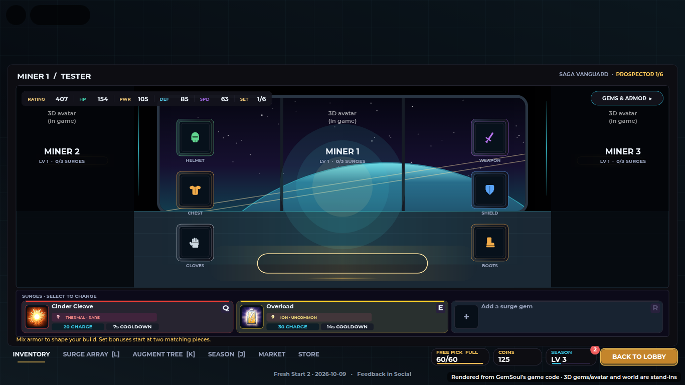
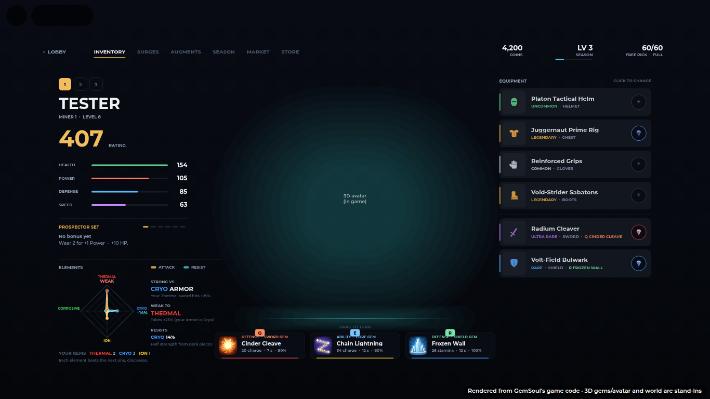
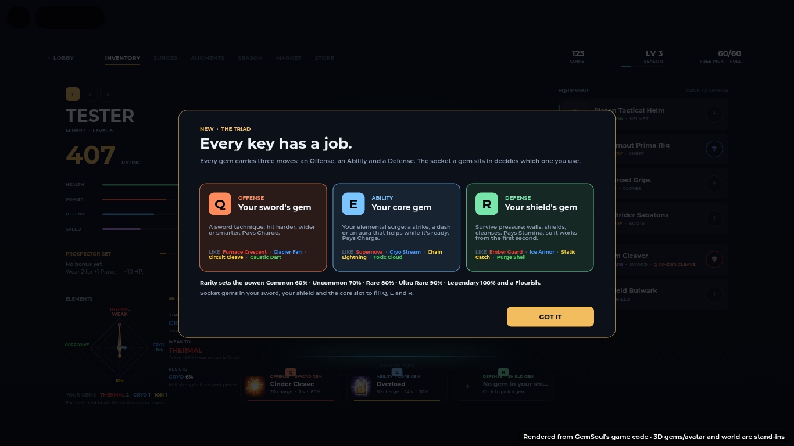

# Inventory v2 and the Q / E / R triad are the defaults (2026-10-13)

The Inventory v2 is now what every player sees. The Q / E / R triad is the way
abilities work. This note records what each one replaced, where the old version
still lives, and how to bring it back. Nothing was deleted.

**Before this change:** commit `0492ab7` on `main`, the last commit with
Inventory v1 as the default. To see any file as it was:
`git show 0492ab7:<path>`; to restore one: `git checkout 0492ab7 -- <path>`.
(To give it a name: `git tag before-v2-defaults 0492ab7 && git push origin before-v2-defaults`.)

| | Now (default) | Replaced (kept) | Switch per player (DEV panel) | Switch for everyone |
| --- | --- | --- | --- | --- |
| Inventory | v2: `src/client/Modules/InventoryV2.luau` | v1: `src/client/Modules/InventoryScreen.luau` | INVENTORY → `V1 OLD` / `V2 CURRENT` | `InventoryV2.DefaultVersion = 1` |
| Q / E / R | the triad: `src/shared/GemTraits.luau` | the classic surge array | ABILITIES → `CLASSIC` / `Q·E·R TRIAD` | `GemTraits.Enabled = false` |

---

## 1. Inventory v2 replaces Inventory v1

| Before | After |
| --- | --- |
|  |  |

The first time a player opens Inventory v2, it shows the triad card once:

### What changed

- `InventoryV2.version(player)` decides which Inventory a player sees. Before,
  the player attribute `InventoryVersion` had to be `2` to show v2; when it was
  unset, players got v1. Now an unset attribute means `InventoryV2.DefaultVersion`
  (`2`). Setting it to `1` still shows v1.
- `Dashboard.client.luau` reads that function everywhere it used to read the
  attribute. It also:
  - cancels a v2 gem drag when another screen opens (it used to cancel only v1's);
  - redraws v2 after the intro instead of v1.
- In the DEV panel, the buttons now read `V1 OLD` / `V2 CURRENT` (they used to
  read `V1 CURRENT` / `V2 NEW`).

### What v1 was (kept as it is)

`InventoryScreen.luau` (3,556 lines) is the station-look Inventory from the
dashboard redesign:

- **Left panel:** the portrait and six ratings, miners 1 / 2 / 3 as live
  loadouts, the six worn pieces with their gem sockets, and the Surge Array
  (Q / E / R).
- **Right panel**, which changes with what you pick:
  - `OVERVIEW`: the picked item, what equipping it changes, and its buttons;
  - `ARMOR`: spare gear, filtered by slot;
  - `GEMS`: your gems, which you drag onto sockets.
- **Bottom:** the other screens and Back to Lobby, plus a build tag.

v1 is still built on every client, hidden behind v2, so switching back is
instant. v1 and v2 send the same server requests (`EquipGear`, `MinerSelect`,
`SocketGem`, `UnsocketGem`, `SocketSurge`, `UnsocketSurge`), so saves work
with either one.
- v1 also asks for `GearPreviews` (its 3D gear shots).
- v2 adds `ReforgeTrait` and `TriadSeen`.

### To make v1 the default again

1. Set `InventoryV2.DefaultVersion = 1` in `src/client/Modules/InventoryV2.luau`.

Nothing else is needed: the toggle, both screens and the server are unchanged.

---

## 2. The Q / E / R triad replaces the classic surge array

The triad has run for everyone since commit `05eab9d`, with
`GemTraits.Enabled = true`. Classic is a per-player DEV switch, saved on the
profile as `Character.LegacySurges = true`.

### Classic (replaced)

- Three surge sockets: `Surge1Gem`, `Surge2Gem` and `Surge3Gem`.
- Q, E and R each fired the single `Surge` of the gem in their socket (Q from
  `Surge1`, E from `Surge2`, R from `Surge3`).
- Every surge cost Charge.

### Triad (now)

- Every gem carries three moves: an Offense, an Ability and a Defense
  (`gem.Traits`).
- The socket a gem sits in picks which move a key fires:

| Key | Reads the gem in | Fires its | Pays |
| --- | --- | --- | --- |
| Q | the sword (`WeaponGem`) | Offense | Charge |
| E | the core socket (`Surge2Gem`, the old E socket) | Ability | Charge |
| R | the shield (`ShieldGem`); with no shield, the sword's gem | Defense | Stamina |

- **The moves:** 60 of them, 4 elements × 3 lanes × 5 moves. They are all in
  `GemTraits.Moves` and also in `CombatTechnology.Catalog`.
- **Rarity:** sets output (Common 60% → Legendary 100%, plus a Legendary
  Flourish). It never changes cost or cooldown.
- **Ranked fights:** everyone is levelled to 80% output, with no Flourish.

### What happened to the old data

- **The retired sockets:** `Surge1` and `Surge3` (`GemTraits.ArchivedSockets`).
  - When a profile loads, a gem left on either one goes back to the pouch.
  - If the pouch is full, the gem stays saved on the socket and is moved on a
    later load (`profile.TriadMoved` stays false until it has been moved).
  - Gems are never cleared.
- **Old gems:** gems from before the triad get their three moves seeded from
  the gem id, so the result is stable on every server and client. A gem's old
  surge keeps its lane where the matrix has it: a Cryo Lance gem keeps Cryo
  Lance as its E.
- **The old surge ids:** `EnergySiphon`, `ResonanceEcho`, `CryoShield` and the
  rest still resolve in `CombatTechnology.Catalog`. `tests/triad_cases.luau`
  fails if one goes missing.
- **The full classic catalog:** the numbers, icons and every file that uses
  each surge are archived in `docs/surge-archive/`.
- **Saved gems:** nothing on a gem is rewritten. The triad projects each gem to
  its key when it's read (`GemTraits.project`), so `gem.Surge` and the rest stay
  as they were saved.

### Who still uses classic

- **The Arena rival:** builds its own surges from its gems' single `Surge`
  (`Systems/Duelist.luau`), as before.
- **Dungeon and raid bosses:** keep their own moves.
- **Any player with `LegacySurges`:** the DEV `CLASSIC` button sets it.

### To go back to classic

- **One player:** the DEV panel's ABILITIES → `CLASSIC`, which sends the
  `DevAbilities` request.
- **Everyone:** set `GemTraits.Enabled = false` in `src/shared/GemTraits.luau`.
  - Q, E and R read `Surge1` / `Surge2` / `Surge3` again.
  - Gems that the triad moved to the pouch stay in the pouch, so players would
    need to socket them again.
