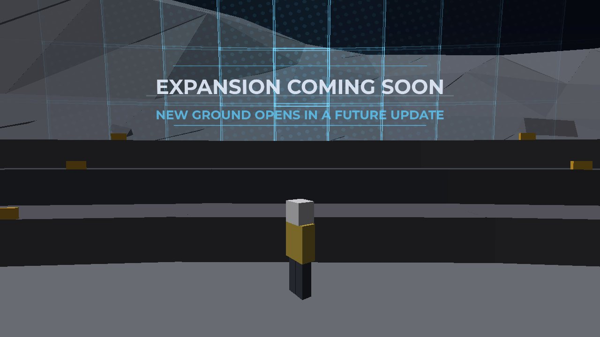
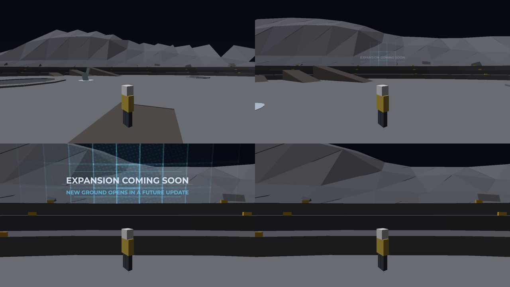
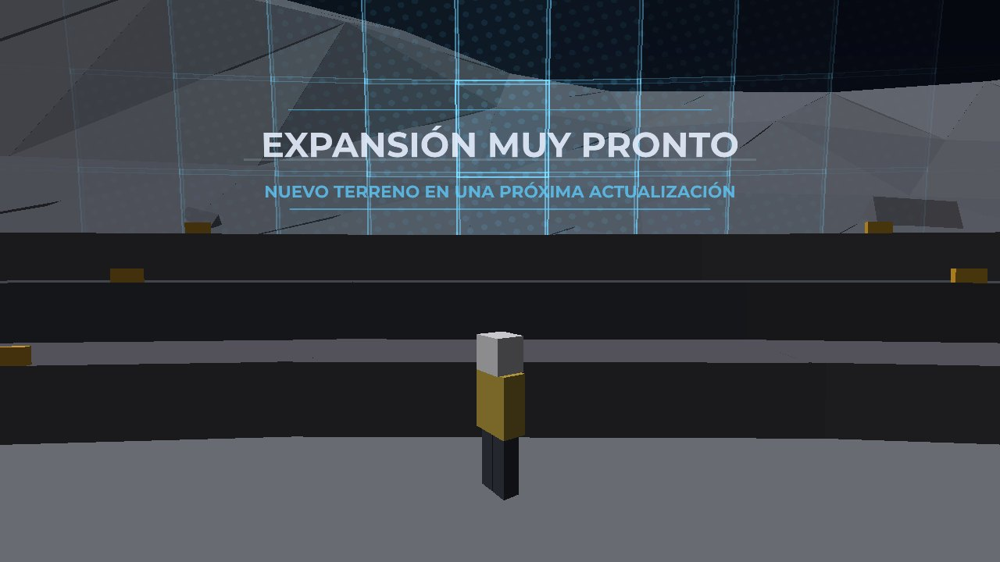
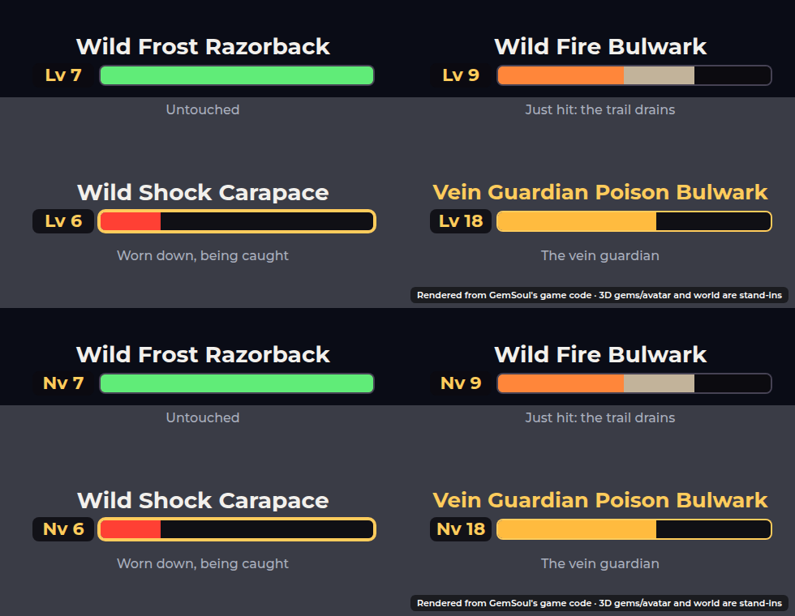

# The quarry's edge, wild kaiju health, quieter fights, kaiju healing

*2026-10-22.* Five changes:

- **The edge of the quarry** is a dome that reads **EXPANSION COMING SOON**
  as you come near.
- **Wild kaiju** show their name, level and a health bar over their heads.
- **Fighting a wild kaiju** draws fewer rifts.
- **Killed and back at base**, your pick is out (miner mode), not your kit.
- **Healing a kaiju with gems**: the "a third while weak" rule is gone, and
  every gem heals a quarter less than it used to.

The pictures are offline renders of the game's own code. The 3D views are
built from `OutpostWorld`'s parts and `EdgeDome`'s panels, and the message
and plates are drawn from their Luau. They are stand-ins, not Roblox
screenshots: in the game the panels use Roblox's animated ForceField
material.

## The edge: EXPANSION COMING SOON

The Outpost ends at its invisible walls, `Shared.Outpost.Edge` (474 studs
from the middle, just past the outermost bench). Over them stands a
force-field dome. Nobody sees it from the middle. Walk toward the edge and
it starts to show:

- **Its panels** (12 studs a side, a ForceField in pale blue) light up
  around the point straight ahead of you. They are brightest there, fade
  out about 70 studs off, and shimmer slowly.
- **How much of it shows** depends on how near you are. Nothing shows from
  170 studs away (`Near`), all of it shows within 40 (`Full`), and it eases
  in between.
- **The message** hangs on the dome straight ahead of you, at eye height
  but always clear of the benches (`Floor`), and follows you along the
  rim: **EXPANSION COMING SOON**, and under it **NEW GROUND OPENS IN A
  FUTURE UPDATE**. It flickers like a hologram. A split ghost of the words
  drifts beside them and jumps now and then, and a scan line rolls down.

Each player's screen draws its own small patch of the dome (17 by 11
panels), snapped to the dome's grid so the panels stay put as you walk.
Only the patch moves round with you. Nothing is drawn while you're far from
the edge, in the Rift, or out of the Outpost. The walls themselves are the
same server walls as before; the dome is only for show.

- `Client.EdgeDome`: `start()` (from Lobby.client), `cell(column, row)`,
  `column(angle)`, `reveal(gap)`, `glow(distance, reveal)`,
  `facing(offset, eye)`, `board(gui)` and `paint(gui, reveal, now)`. The
  message is a SurfaceGui in PlayerGui, so it's translated.
- `Shared.Outpost.Edge`: where the walls stand (`Server.OutpostWorld` reads
  it).

## Wild kaiju: name, level, health

A wild kaiju now has a slim plate over its head. It shows the kaiju's
name, a level chip (**Lv 7**; **Nv 7** in Spanish) and a health bar. The
bar uses the outline's colours: green, then amber, then red as it's worn
down. A pale trail shows what the last blow took, then drains away after a
moment. The vein guardian's name is gold. A kaiju being caught gets a gold
edge on its bar, with the gold **READY TO CATCH** words sitting just over
the plate.

The plates show for the 6 nearest wild kaiju within 140 studs, and never
for one that's knocked out. Your kaiju and the rift's critters still show
their health on their bodies only.

- `Client.WildBars`: `watch(model)` (KaijuHud's scan hands it each wild
  kaiju), `start()`, `plate(model)`, `draw(plate, share, trail, guardian,
  catching)`, `choose(entries, budget, range)`.

## Fewer rifts while you fight a wild kaiju

Out past the core, in a fight with a wild kaiju, the frontier holds back
(`Frontier.Engaged`):

- your noise builds at a quarter of its usual rate;
- the next encounter waits 30 seconds after the last;
- no wandering rift opens by you.

You count as being in a fight if you started on the kaiju and did
something in the fight in the last 15 seconds, or if you're casting a
catch on it. `KaijuWilds.engagedWith(player, within)` says so, and
`FrontierServer` sets `FrontierEngaged` on you each half second. The fight
ends after 15 quiet seconds, or when the kaiju is knocked out. See
[frontier.md](frontier.md#fighting-a-wild-kaiju-fewer-rifts).

## Back at base in miner mode

Killed in the Outpost (in the core, or robbed out past it), you're back at
base with your pick out. If your combat kit was out, it's put away, and a
spar you were in ends (`FrontierServer.kitAway`, which Main sets to
`SparServer.unpair`). Respawning into a new body already did this.

## Kaiju healing

- **Back to how it was.** A kaiju that comes back by itself after a
  knockout is at 15% health again. Gems heal it like any hurt kaiju: there
  is no more "weak: gems heal it at a third till it's full"
  (`record.Weak`, `Revive.Weak` and `Kaiju.healShare` are gone).
- **Then a quarter less.** Each point of a gem's power now heals 7.5% of a
  kaiju's health, down from 10% (`Kaiju.Infuse.Mend`). A Common of no
  element heals 7.5%, one of its own element 15%. From 15% health back to
  full takes 12 Commons, or 6 of its own element. Before this change it
  took 27 (weak), and at first 9. The HEAL tab shows each gem's share to
  the nearest half (+7.5%).

## Tests

- `tests/edge_dome_cases.luau` (`run_edge_dome`): the walls stand at
  `Outpost.Edge`, panels sit on the dome facing in and meet all the way
  round, how much shows and where it lights, the message straight ahead,
  facing in and clear of the benches, its board lit and unlit, the Spanish.
- `tests/wild_bars_cases.luau` (`run_wild_bars`): which plates show, the
  plate and its parts, the bar's colours and trail, the guardian and the
  gold edge, a long name that shrinks to fit, wired into the HUD, the
  catch words above the plate.
- `tests/frontier_cases.luau`: `Frontier.Engaged`, quieter noise and the
  longer gap in a fight (alone too).
- `tests/kaiju_server_cases.luau`: in a fight with a wild kaiju (or
  catching one), `FrontierEngaged` is set, swings make a quarter of the
  noise, no encounter comes in the usual gap, and no wandering rift opens;
  once the fight goes quiet the encounter comes. Killed in the core or
  robbed, you're back at base with your kit away. A 20% heal takes three
  Commons, and auto heal takes four for 30%. The weak-revive checks are
  gone.
- `tests/kaiju_cases.luau`: the weak-revive checks are gone (the heal
  checks follow `Infuse.Mend`).
- `tests/lobby_death_cases.luau`: back at base puts the kit away.
